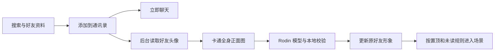

# 添加好友与后台森林形象

好友 → ＋ → 搜索昵称或账号 → 查看资料 → 添加到通讯录。添加成功后立即可以发消息；根据头像准备森林形象在后台自动进行。用户不需要进入制作向导、填写形象描述、确认中间图片或再点击加入森林。

当前没有远程账号服务，搜索基于本机联系人资料，界面明确标注范围。内置好友已有按头像制作的模型，直接复用。新联系人可录入对方的昵称、账号和头像；以后接入账号目录时，可以直接使用同一资料页与添加后任务流程。

## 配置范围

图片接口仅从项目内 `.forest-avatar-data/image-config.json` 读取 `baseURL`、`apiKey`、`model`、`size`。本机已写入用户指定接口与密钥，图片模型采用该接口实际返回的 `gpt-image-2`。不读取或修改 Codex 全局模型、provider 或 `auth.json`，浏览器不接收密钥；没有服务设置页面或配置写入接口。私有目录已被 Git 忽略，本项目 Node 服务不会通过 HTTP 提供其中的配置文件。

此前误改的 Codex 全局配置和认证文件已从修改前备份恢复，原 provider `deemos` 和模型 `gpt-6-astra` 已恢复，认证文件与备份逐字节一致。复核时保留了其他会话随后新增的项目记录；全局模型、provider 和其他设置与修改前一致。用户先前授权配置的 Hyper3D MCP 与 OAuth 保留。范围复核见 `validation/avatar-pipeline/config-scope.json`。

Hyper3D 优先使用项目私有 `.forest-avatar-data/hyper3d-config.json` 的 REST 配置（`baseURL` 固定为 `https://api.hyper3d.com/api/v2`，`apiKey` 仅服务端读取）；不存在该配置时，通过本机 Codex 的 app-server 工具接口复用 OAuth，不运行模型对话，不提取或复制 OAuth token。REST 模式无需安装 Codex，订阅查询密钥也仅保存在该私有目录，不返回浏览器。修改配置后须重启 Node 服务。已验证的工具：`rodin_create_uploads`、`rodin_import_images`、`rodin_generate`、`rodin_get_status`、`rodin_wait`、`rodin_get_result`、`rodin_generate_bang`。这些工具没有图片生成能力，全身图由项目图片接口生成。

## 任务与运行

- 好友关系先保存在 IndexedDB，然后使用持久化的好友任务 ID 启动形象制作。默认不置顶新朋友，正常聊天、收取来信、草稿和置顶操作均可在准备期间使用。
- `src/friend-models.js` 在页面载入和添加好友后自动恢复任务，先查询原编号，只有不存在时才提交。后台生成完成后直接更新同一个好友，不创建第二个好友、不覆盖账号、头像、消息、草稿或置顶。
- 进度显示在好友资料中；聊天头像和好友列表更多菜单均可打开资料。已完成后可选查看 3D 形象，没有额外入场确认。没有形象或形象失败时仍保留正常好友，场景不使用伪装成生成结果的占位人物。
- `npm start` 启动本地 Node 服务。Electron 主窗口保留 `file://` 和原有 IndexedDB，通过限定路由的主进程 IPC 接入桌宠本机服务的头像 API；生成模型与预览走同一 loopback 服务，不要求另开 npm start。新增主进程/preload 接线后必须从托盘完全退出再启动，单独关闭或刷新窗口不足以更新。已经提交的任务在收起资料或关闭浏览器后仍由服务继续；Node 服务须保持运行。刷新后继续查询原任务。没有待处理任务时停止轮询，页面隐藏时暂停浏览器轮询。
- 相同任务 ID 的并发请求只提交一次。提交超时、5xx 或结果不明时暂停，不自动重交付费步骤。已确认失败可从资料页重试；结果不明仍保持暂停，聊天不受影响。已知 Rodin 编号可通过开发接口恢复查询。
- 场景按最近消息保留前九位形象就绪的好友，沿用随机安全选位和通用程序姿态，没有新增骨骼绑定。独立桌宠支持加载当前自定义好友任务对应的本地 GLB，并同步昵称；昵称超过五个 Unicode 字符时显示前五字加 `...`，极简模式仍不显示姓名或消息提示。

## 实现与验证

| 设计条目 | 实现位置 | 验证证据 |
| --- | --- | --- |
| 正常添加朋友、搜索和资料页 | `src/social-conversations.js`、`src/avatar-friend-ui.js` | `browser-results.json`：搜索 → 资料 → 添加 → 立即聊天，界面无制作向导、描述、置顶与手动加入步骤 |
| 先保存好友，再后台生成 | `src/social-store.js`、`src/friend-models.js` | `friend-model-results.json`：模型准备前好友和聊天已可用；服务离线不回滚好友 |
| 自动恢复与原地更新 | 同上 | 刷新只查询原任务，不重复提交；就绪后只更新原好友模型，消息、头像、草稿、未读和置顶保留；任务结束停止轮询 |
| 模型就绪后自动入场 | `src/social-characters.js`、原有在场控制器 | 浏览器验证：未读好友模型准备期间没有假人物，就绪后直接出现；自定义人物渐显 |
| macOS 式窗口、焦点、手机布局 | `avatar-friends.css`、共享 `ui-interactions.js` | 桌面 1440×1000、手机 391×844、短窗口 391×480；Esc 返回来源，减少动态效果时无缩放动画 |
| 后端生成与扣费边界 | `server/avatar-pipeline.mjs`、`server/hyper3d-client.mjs` | `unit-results.json`：并发去重、暂停不明结果、重启、查询原编号、GLB 校验；兼容接口仍保留手动中间图确认能力，正常添加流程固定自动继续 |
| 项目私有配置 | `server/image-config.mjs`、`server/avatar-api.mjs` | `config-scope.json`、`connection.json`：不改 Codex 全局接口和认证，配置 HTTP 404；界面无地址/模型/密钥表单 |

执行 `npm run build`、`npm test`、`npm run test:avatar`。浏览器测试使用 Edge、独立浏览器数据和模拟供应商，不产生生成费用。`scripts/smoke-avatar-live.mjs <允许使用的头像路径>` 是需要明确单独运行的付费验证入口，不属于自动测试。

截图：`desktop-add-search.jpg`、`desktop-background-model.jpg`、`desktop-auto-model-ready.jpg`、`mobile-contact-add.jpg`、`mobile-auto-model-ready.jpg`。录像：`avatar-flow.webm`。以上文件均在 `validation/avatar-pipeline/`。

本轮构建、现有数据、在场规则、Dock/浮层/聊天交互回归均通过，汇总见 `normal-add-regression.json`。

## 真实服务证据与未验证项

此前已完成 Hyper3D OAuth，列出 7 个工具，实际调用上传准备接口并得到上传 ID 与 PUT 方法。图片模型列表已连通。10 月 15 日使用已有袋鼠头像进行一次实际图片编辑验证，服务返回 502；记录为 `live-result.json`，任务保持暂停，没有自动重试，也没有随后提交 Rodin 付费生成。本轮交互修改没有重复真实付费请求。

截图与录像使用已有袋鼠图片/GLB 模拟供应商，证明的是正常添加和后台接入，不能代表新生图或新 Rodin 生成质量。实际全链路新资产生成成功、任意真人头像辨识度、模型朝向与服饰质量、真实手机实测、远程账号搜索与好友验证尚未验证或接入。
