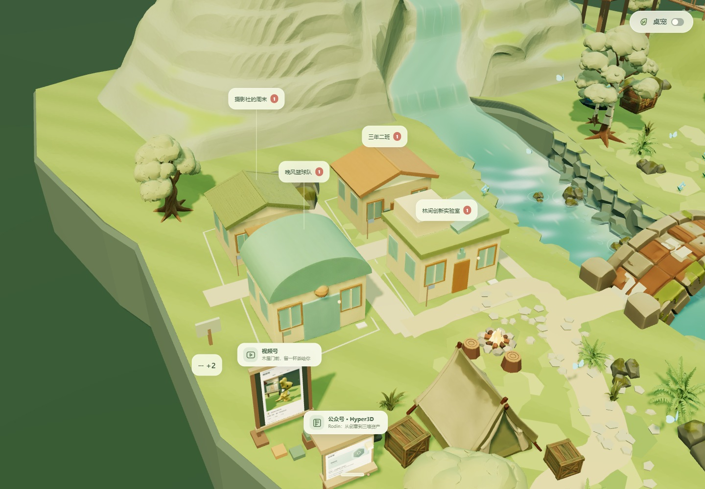
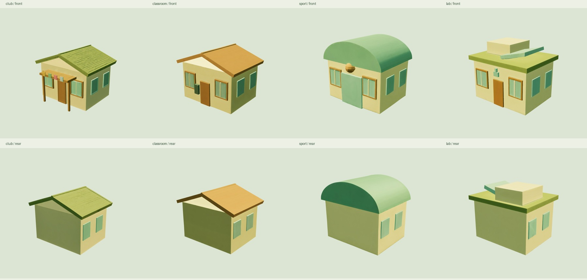

# 林间群落 · 四格版实现与验收（历史）

当前已升级为 [3×3 九格与九种 Rodin 建筑](GROUP-NINE-REVIEW.md)。以下保留四格版实现和验证记录。

完成日期：2026-10-16。群聊已经接入主应用，不是独立演示页面。刷新 `http://localhost:8080/`，从底部「消息 → ＋ → 发起群聊」创建；或点击庭院旁的「··· → 体验校园群聊」，体验六个示例群和候场机制。

[桌面全景](validation/group-chat/desktop.jpg) · [手机场景](validation/group-chat/mobile.jpg) · [群聊窗口](validation/group-chat/group-chat.jpg) · [桌面群资料](validation/group-chat/group-info.jpg) · [手机群聊](validation/group-chat/mobile-chat.jpg) · [手机群资料](validation/group-chat/mobile-info.jpg) · [实际操作录像](validation/group-chat/group-flow.webm)

## 已实现的行为

- 原木屋区域改成四格庭院。移除木屋、前侧遮挡手推车和用地内杂物；西岸边缘略向外扩展，发现设施移到庭院外侧。桥、营地、后方山脉、右侧广场与山腰栈道保留。
- 消息列表混排好友和群聊；通讯录分别展示好友数量及群数量。会话置顶不限，场景常驻最多三个，二者独立。
- 四格共享全部建筑类型，同类型的多个群可同时入场；没有常驻群时四格都展示未读，有三个常驻时仍留一格流转。
- 未读建筑入场后不换格；非驻留群读完、关闭聊天后等待 800ms，再用 450ms 渐隐，按最早未读顺序递补。聊天中保持轮廓高亮，淡出中来信可在原位恢复。
- 列表与候场牌可以直接打开任何群，不强行召出建筑；候场列表不会清除未读。候场牌数字是未进入场景的群数量。
- 建群、群名、类型、公告、成员管理、退出确认、成员头像拼图、群成员数、@成员/@所有人、文字、图片、表情、表情包及发现内容分享均接入现有工作区。
- 草稿、待发图片和阅读位置按会话保存。历史阅读时新消息不会强行滚到底部，只有实际显示的消息才标记已读；遮挡聊天的模态窗口和后台页面不触发已读。
- 建筑或列表打开群聊不拉动镜头；由个人聊天切换到群聊也保留当前镜头。桌面群资料扩展成第三栏，窄屏覆盖聊天区域，手机采用单面板前进与返回列表。
- 手机全景中四个群名按庭院槽位排列为两行，用细线指回建筑，避免遮挡；放大后恢复附近标签。报刊亭、放映场入口在手机收成 44px 图标，保留完整无障碍名称。
- 示例群只在点击体验后创建，不增加好友数量。示例来信每群约 45–90 秒一次；发送消息有本地模拟回复，遵守全局暂停和后台暂停。

## 设计条目 → 实现位置 → 验证证据

| 条目 | 实现位置 | 证据 |
| --- | --- | --- |
| 统一会话、群数据、成员、置顶与常驻、旧数据兼容 | `src/group-catalog.js`、`src/group-store.js`、`src/social-store.js` | [数据与规则测试](validation/group-chat/data.json)；现有四项数据测试通过 |
| 四个稳定槽位、先进候场、关闭后退出、淡出反转、常驻优先 | `src/group-presence.js` | 同上；[实际递补截图](validation/group-chat/queue-filled.jpg) |
| 地形、四块永久保留用地、格间通路、场景建筑与选择 | `src/community-layout.js`、`src/group-scene.js`、共享地表与布局 | [通行检查](validation/group-chat/scene.json)、[社区近景](validation/group-chat/community.jpg) |
| 好友/群混排、数量、搜索、右键/长按/更多、建群与群资料 | `src/social-conversations.js`、`src/group-ui.js`、`group-chat.css` | [浏览器流程](validation/group-chat/browser.json)、桌面及手机截图 |
| 共用聊天、来源展开、可见已读、提及、草稿和分享 | `src/social-ui.js`、现有 UI 控制器 | 同一浏览器流程包含真实建群、图片、@、分享、历史阅读、手机返回 |
| 资产复用、失败回退、名称标签与轻量轮廓 | `src/group-building-model.js`、`src/group-scene.js` | [资产检查](validation/group-chat/assets.json)、[失败回退手机图](validation/group-chat/fallback-mobile.jpg) |
| 原广场、观景台、发现设施和河流 | 现有山谷、发现与河流模块 | [广场浏览器回归](validation/group-chat/regression/valley-browser.json)、[发现设施回归](validation/group-chat/regression/one-click-browser.json)、[地形](validation/group-chat/regression/valley-geometry.json)、[河流](validation/group-chat/regression/river-geometry.json) |

新增接口以 `ConversationRef = {kind: 'friend' | 'group', id}` 和 `openConversation(ref, {origin})` 为入口，原 `openFriend()` 仍可用。好友草稿键保持不变，群使用 `group:<id>` 命名空间；新增字段补默认值，不重置 IndexedDB。好友未读仍独立驱动人物，群未读驱动建筑。

## Rodin 资产来源

通过已有 Hyper3D MCP OAuth 实际生成四次，每种一次，无追加修订。参数均为 `Gen-2.5-Medium / Raw / 30,000 / GLB`。四款均保留原始生成文件，运行时统一缩放、底面对齐，实验室额外绕 Y 轴旋转 90°，使门口朝向社区步道。

| 类型 | 任务 ID | 场景模型 |
| --- | --- | --- |
| 社团会馆 | `8e273234-f98d-43f5-bc6a-d4a9e2e15230` | [club/scene.glb](assets/rodin-groups/club/scene.glb) |
| 小教室 | `1f053b81-13da-4bc2-ad40-f7210baf9ac7` | [classroom/scene.glb](assets/rodin-groups/classroom/scene.glb) |
| 体育馆 | `41e86f83-7bce-4946-b3aa-1441f57f5b46` | [sport/scene.glb](assets/rodin-groups/sport/scene.glb) |
| 实验室 | `2161f1e4-b0d9-46f4-9ce5-d9598607133d` | [lab/scene.glb](assets/rodin-groups/lab/scene.glb) |

[总清单](assets/rodin-groups/manifest.json) 链接每款提示词、两张程序参考、源文件、SHA-256、朝向和实际尺寸。已检查正面、背面及场景同屏效果；采用的是简洁微缩建筑，生成细节以实际模型为准。实际扣费未在结果中返回，不估算 credits。私有任务回执与签名下载地址保存在 Git 忽略的 `records/group-buildings/`。

模型加载与使用不调用生成接口。`scripts/generate-group-buildings.mjs` 复用已有任务编号；提交状态不明时停止，不自动重新付费。每个群复用模板，群名、颜色标记、未读信件和轮廓由前端控制。

## 验证与性能

已完成构建及以下相关检查：

- `npm test`：现有社交存储、朋友圈、发现存储和桌宠状态测试通过。
- `test-group-chat.mjs`：混合置顶、独立草稿、四格候场、聊天保持、退出递补、淡出反转、常驻替换、选择性已读、成员编辑、退出及持久化通过。
- `test-group-scene.mjs`：旧木屋停用、四款模板均适配四格、空地保留、138 个步道采样可容纳半径 0.63 的人物、候场牌占地阻挡通过。
- `test-group-browser.mjs`：真实 UI 建群、提及、发图、草稿/附件隔离、分享、群资料、候场直接打开、实际建筑点击、镜头不移动、已读关闭后递补、历史阅读、新常驻替换、手机返回和单模型失败回退通过，无页面脚本异常。
- 原山谷浏览器测试覆盖四角色拖放、坡路散步、八角色聚会、结束恢复、手机与横竖屏；发现设施测试覆盖自动进入、文章和视频状态、返回镜头及减少动态效果，均通过。
- 原地形、河流与山腰平台几何检查通过；手机场景四个群名均达到 44px 点击高度，且实际触摸点入群通过，见 `validation/group-chat/capture.json`。测试针对受影响功能，没有重新执行无关的全部资产验证。

Windows 本机 Edge、1440×1000、流水与人物动作开启，**四个人物＋四栋建筑＋两个候场群**，30 帧预热后采集 300 帧：[性能记录](validation/group-chat/performance.json)。本次观察的帧间隔中位数约 16.7ms、P95 约 16.8ms；本次为 330 次绘制调用、824,749 个场景三角面。

这是受约 60Hz 同步影响的单设备帧间隔，不是 GPU 执行时间，也不是手机性能承诺。手机检查为 391×844 浏览器模拟，未做真机、多人联网或长期运行测试。群聊数据与回复仍是本地体验，不接入微信真实数据或多人服务器。

复现：先运行 `npm start`，再执行 `npm run test:groups`。最终源码和 `dist/world.js` 已更新；此轮未提交或推送 Git。
