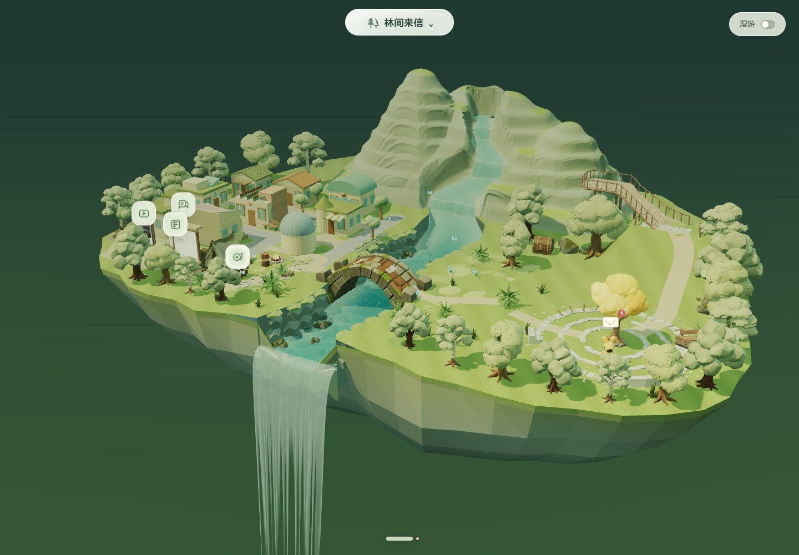
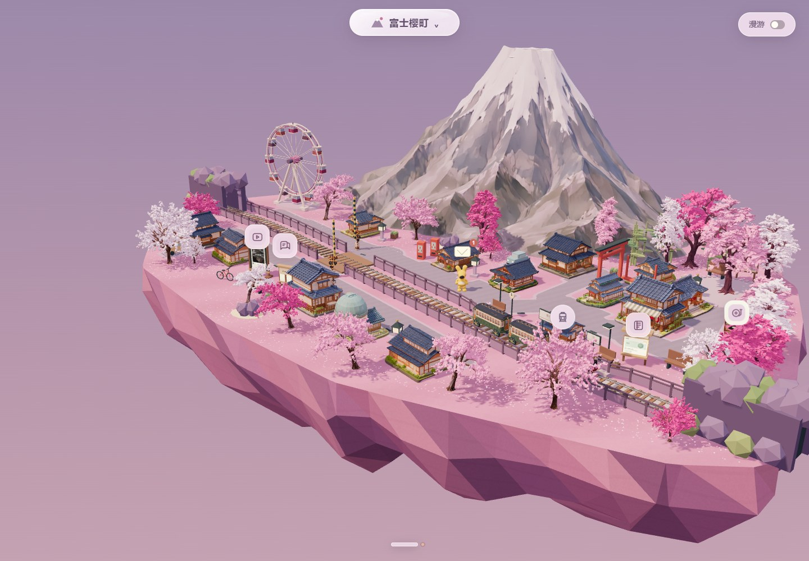
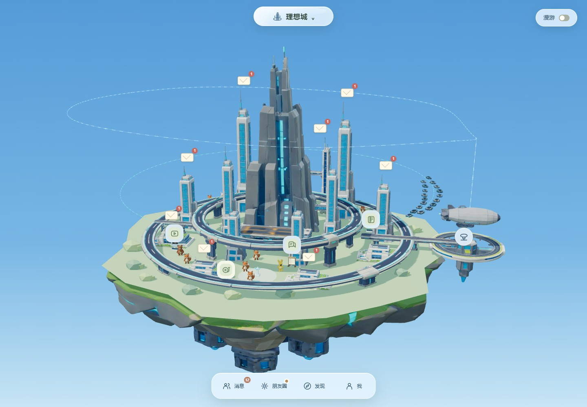

# Techathon2026 · 林间来信

把聊天、好友和群聊放进三维风景中的本地社交软件。当前提供 **林间来信、富士樱町、理想城** 三个可切换场景，共享好友、群聊、消息、草稿与阅读位置。

主仓库：[szddddddd/Techathon2026](https://github.com/szddddddd/Techathon2026)。运行版本：1.3.1。

## 启动

Windows 安装 Node.js 22 或更新版本，双击 **启动林间来信.cmd**。启动器会安装依赖、构建并打开 `http://localhost:8080/`；端口占用时选择可用端口。桌宠可通过 **启动桌宠.cmd** 启动。

手动启动：

```powershell
npm install
npm run build
npm start
```

保持服务运行，通过 HTTP 打开网页，不要直接双击 `index.html`。需要 Electron 主窗口时执行 `npm run desktop`。

## 当前场景

| 场景 | 内容 | 入口 |
| --- | --- | --- |
| 林间来信 | 森林、连贯山脉与溪流瀑布、临河街区、山腰观景台 | `/?scene=forest` |
| 富士樱町 | 粉色浮空岛、富士山、樱花街区、落瓣、铁路道口与停站列车、摩天轮 | `/?scene=fuji` |
| 理想城 | 原生 Blender 殖民舰巨塔、白色楼群、双层环路、空港与云海浮空岛 | `/?scene=ideal` |

顶部玻璃按钮切换场景，鼠标远离时收为小球。场景中的人物、群聊建筑和公共设施连接同一套社交功能。





理想城采用 `assets/ideal-city/source.blend` 中的完整可编辑场景，九栋原有外围建筑接入群聊。建筑外观固定为原场景设计，绑定的群类型和其他社交数据跨场景共享。主岛地面供好友活动，高架环路用于立体交通。

## 操作与功能

- 左键旋转、右键平移、滚轮缩放；按住人物可拖动安放。
- 底部 Dock 提供消息、朋友圈、发现和个人资料，闲置时收起。
- 消息列表混排好友与群聊，支持搜索、置顶、文字、图片、表情、分享及独立草稿。
- 九栋群聊建筑提供场景会话入口；群资料可编辑成员、公告和建筑类型。
- 好友资料支持添加联系人与查看形象；新好友根据头像在后台准备三维模型，见 [形象生成配置](AVATAR-PIPELINE.md)。
- 公众号、视频号和音乐设施支持阅读、播放与分享；聚会入口召集场景中的好友。
- 列车、飞艇和悬浮载具可进入观景跟随。Esc 或手动操作镜头退出。
- Windows 桌宠与网页共享本机社交状态。

这是本地产品体验，不连接微信数据或多人聊天服务器。消息与媒体保存在浏览器 IndexedDB；清除浏览器网站数据会影响本机内容。

## 项目结构

| 位置 | 用途 |
| --- | --- |
| `index.html`、根目录 CSS、`startup.js` | 网页入口、界面与启动页 |
| `src/` | 三维场景、共享交互、社交数据、人物与桌宠源码 |
| `assets/` | 当前采用的模型、头像、音乐、视频和图片，含运行所需回退资源 |
| `dist/` | 构建后的网页、形象预览与桌宠脚本 |
| `server/` | 静态服务和好友头像到三维模型的任务流水线 |
| `desktop/` | Electron 主进程、桌宠桥接和运行配置 |
| `scripts/` | 构建、启动与当前功能测试 |
| `docs/images/` | 当前三个场景的网页截图 |
| `asset-review.html` | 好友形象预览与当前森林模型查看器 |

测试输出放在忽略的 `.test-results/`；本机密钥与形象任务保存在忽略的 `.forest-avatar-data/`，均不提交到仓库。

## 检查

```powershell
npm run build
npm test
npm run test:assets
npm run test:forest
npm run test:groups
npm run test:scenes
npm run test:ideal
```

浏览器测试需要先启动本地服务，使用独立浏览器数据；`FOREST_TEST_URL` 可指定测试服务地址。浏览器尺寸模拟不等同于真实手机测试。专项检查可从 `package.json` 或 `scripts/test-*.mjs` 运行。
