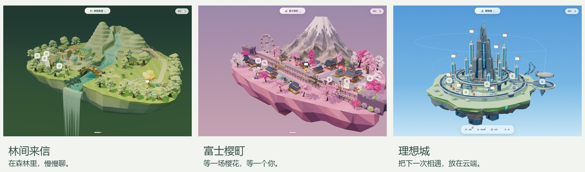
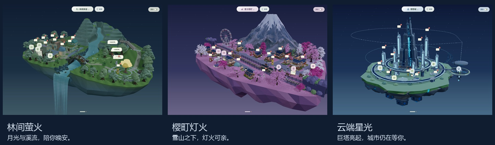

<div align="center">

# WeRoam

**v0.1 beta · 让每一次聊天，都有一处风景。**

基于 Three.js 的三维空间社交原型，提供浏览器体验、Windows 桌面端与 Android 容器。

[](https://github.com/szddddddd/Techathon2026/actions/workflows/ci.yml)
[](https://nodejs.org/)
[](LICENSE)

A Three.js spatial social prototype for the browser, Windows desktop and Android.

</div>



[快速开始](#快速开始) · [能力与边界](#能力与边界) · [工程结构](#工程结构) · [开发与验证](#开发与验证) · [文档索引](docs/README.md) · [参与贡献](CONTRIBUTING.md)

## 快速开始

需要 **Node.js 22+、npm**，以及支持 WebGL 2 的现代浏览器。以下命令从项目根目录执行；首次安装需要联网。

```powershell
git clone https://github.com/szddddddd/Techathon2026.git
cd Techathon2026
npm ci
npm start
```

打开 [http://localhost:8080/](http://localhost:8080/)，保留服务终端，按 `Ctrl+C` 停止。端口以终端输出为准。构建产物 `dist/` 不纳入 Git；`npm start` 会通过 `prestart` 自动检查并生成构建。日常也可运行 `npm run dev`，修改源码后重新构建并刷新；当前没有自动监听。

**基础场景与本地消息演示无需生成服务密钥或真实社交账号。** 添加好友时的在线模型生成、真实邮箱和邮箱 Agent 各有单独配置与授权，见下文。Windows 也可双击 `启动 WeRoam.cmd`，启动器会准备依赖并构建。

需要在同一局域网的手机浏览器演示时，运行 `npm run start:lan`，按终端提示访问；该入口只提供静态资源，头像生成 API 继续留在回环服务中。

### Windows 桌面端与桌宠

完成依赖安装与构建后：

```powershell
npm run desktop
```

桌宠可使用 `启动桌宠.cmd`。真实邮箱连接仅在 Electron 中提供：`npm run mail:connect` 打开 QQ 邮箱连接，`npm run mail:connect -- --mail-provider=netease` 选择 163。授权码仅在独立本地窗口填写，详见[邮箱接入](docs/MAIL-INTEGRATION.md)。

### Android 与 WebXR

Android 另需 JDK 17+、Android SDK 和 Gradle 工具链；依赖准备见 [Android 构建说明](docs/ANDROID.md)。

```powershell
npm run android:build
npm run android:download
```

APK 输出到 `downloads/`，下载页供可互访局域网中的手机使用。签名文件需要自行备份；手机数据与电脑数据不自动同步。Android 头像生成演示的配置与限制另见 [Android 头像说明](docs/ANDROID-AVATAR-DEMO.md)，它不等于桌面服务端流程。PICO / Quest 的 WebXR 场景浏览见 [VR 指南](docs/PICO-VR.md)，实体头显表现仍需实机验证。

## 能力与边界

| 模块 | 当前实现 | 使用边界 |
| --- | --- | --- |
| 三维世界 | 林间来信、富士樱町、理想城，昼夜切换、角色与场景设施交互 | 产品原型；移动端帧率与设备兼容性需实机测量 |
| 好友、群聊与消息 | 本地会话、草稿、好友角色与群聊建筑 | 没有接入真实微信账号、QQ 社交私信等完整平台接口 |
| Universal Inbox | 合成消息、手动收录、来源引用、权限演示和模拟发送 | 浏览器演示操作写入本机；受限来源通过原应用处理 |
| 桌面邮箱 | QQ / 163 IMAP 读取、本地加密保存和草稿 | 不发送、不删除、不修改远端邮件；163 尚待真实账号验收 |
| 邮箱 Agent | 用户选择并授权后，向固定校内模型服务提交必要邮件文本，提供摘要、待办和候选回复 | 独立配置、双权限及逐次确认；候选回复只保存为本地草稿 |
| 创意工坊 | 安装、停用、固定、卸载本地 Mod，部分模块可放置场景建筑 | 本地内置模块机制，尚非远程第三方插件市场 |
| 头像到模型 | 图像参考生成、Rodin 任务跟踪及 GLB 更新 | 需要有权使用的输入与付费服务配置；任务不明时查询原任务 |

浏览器数据保存在 IndexedDB，桌面真实邮箱数据由 Electron 单独加密管理。不要把本地演示权限流程当作面向公网的身份认证。当前开发服务默认监听回环地址，不应直接部署成公开的生成服务。

### 体验入口

- [Universal Inbox 演示](http://localhost:8080/?scene=forest&inbox=1)：主动点击“体验示例”载入合成消息；[功能说明](docs/UNIVERSAL-INBOX.md)。
- [创意工坊](http://localhost:8080/?scene=fuji&workshop=1)：管理便签、专注计时和内容模块；[功能说明](docs/WORKSHOP.md)。
- [邮箱 Agent](docs/MAIL-AGENT.md)：真实邮件权限、配置、数据流与[验证记录](docs/archive/mail-agent-validation.md)。

## 工程结构

```text
Techathon2026/
├── index.html / pet.html / *-review.html / data-transfer.html
├── src/                 # 共享前端入口
│   ├── scenes/          # forest / fuji / ideal / shared
│   ├── characters/      # 角色、骨骼、动作与桌宠
│   ├── social/          # 好友、群聊与消息
│   ├── discovery/       # 内容设施与媒体预览
│   ├── rendering/      # 资源、几何与渲染辅助
│   ├── ui/             # 界面、主题、交互与控件
│   ├── platform/       # 移动端、WebXR 等平台适配
│   ├── audio/          # 音频与场景音乐
│   ├── review/         # 模型与骨骼查看工具
│   ├── styles/         # 页面与模块样式
│   ├── inbox/          # Universal Inbox
│   └── mods/           # 内置 Mod 与创意工坊
├── server/              # 本地 HTTP、头像任务与 Rodin REST 适配
├── desktop/             # Electron、隔离桥接、邮箱及 Agent
├── android/             # Android 原生容器与 Gradle 工程
├── mobile/              # Android WebView 前端桥接与样式
├── assets/              # 模型、图片、媒体与资产来源记录
├── config/              # 无真实密钥的本机配置模板
├── scripts/             # 构建、启动、打包、诊断与基准工具
├── tests/               # 自动化验证脚本
├── docs/                # 架构、功能、开发与验证说明
└── dist/                # 本机构建输出，不提交
```

根目录 HTML 保留为稳定页面入口；业务实现位于 `src/`。各层职责、入口与数据目录见[项目结构](docs/PROJECT-STRUCTURE.md)。

### 文档导航

| 我想…… | 从这里开始 |
| --- | --- |
| 运行项目、配置开发环境 | [开发指南](docs/DEVELOPMENT.md) |
| 理解代码与数据流 | [目录职责](docs/PROJECT-STRUCTURE.md) · [技术架构](docs/TECHNICAL-ARCHITECTURE.md) |
| 使用收件箱、工坊、头像或移动端 | [功能与平台指南](docs/README.md#功能与平台) |
| 查素材来源和使用许可 | [资产目录](assets/README.md) · [第三方资源](docs/THIRD-PARTY-RESOURCES.md) |
| 查看阶段计划与旧验收数据 | [历史档案](docs/archive/README.md) |

当前指南以 Markdown 为维护源；PDF 使用 `python scripts/export-project-docs.py` 按需导出到被忽略的 `output/pdf/`，依赖与字体要求见脚本说明。

## 开发与验证

```powershell
npm run build
npm run test:structure
npm test
npm run test:inbox
npm run test:mods
npm run test:performance
```

按修改范围选择测试。浏览器测试使用 Playwright，多数现有交互套件指定 Windows Microsoft Edge 与 D3D11；已安装 Edge 的当前 Windows 环境可直接运行例如 `npm run test:inbox:browser`。下载 Playwright Chromium 不会自动适配这些套件，其他环境须先核对脚本。测试可能启动本地服务，结果写入被忽略的 `.test-results/`。构建成功、模拟供应商通过和设备实机验收是不同证据，不能互相替代。

完整环境、命令分组、调试与配置说明见[开发指南](docs/DEVELOPMENT.md)。提交前请阅读 [CONTRIBUTING.md](CONTRIBUTING.md)。

### 可选服务配置

配置文件应留在项目私有目录。不要将真实密钥、邮箱授权码、用户消息或签名文件加入源码、日志、截图或 Git。

- **头像图像服务：** 从 [`config/`](config/README.md) 的占位模板复制到 `.forest-avatar-data/image-config.json`，格式见[头像流程](docs/AVATAR-PIPELINE.md)。
- **Rodin：** 项目所有生成、任务状态和结果查询统一使用 `.forest-avatar-data/hyper3d-config.json` 的 `apiKey`，通过 `server/rodin-rest-client.mjs` 访问 REST。缺失配置时报错，不回退至 MCP OAuth、全局配置或环境密钥。每个新物体先生成独立 imagegen 参考图，再提交 Rodin；结果不明时查原任务，避免重复扣费。
- **桌面邮箱 Agent：** 以 `desktop/agent-config.example.cjs` 为模板，在 `.weroam-private/agent-config.cjs` 填写本机配置，见[使用说明](docs/MAIL-AGENT.md)。

Android 既有头像演示实现与桌面私有配置入口不同，尚未统一到上述 Node REST 客户端；后续维护与新增调用须遵循项目约束。

## 场景预览

| 林间来信 | 富士樱町 | 理想城 |
| :---: | :---: | :---: |
|  |  |  |



12 分钟的昼夜周期，也可以停留在喜欢的时间。上图均为项目运行画面。

## 许可与安全

项目原创代码按 [ISC License](LICENSE) 分发。第三方依赖、模型、音乐、视频、文章、图片和品牌标识保留各自权利；根许可证不替代它们的授权。部分素材尚缺完整来源或许可凭证，不能仅凭本仓库声明判断其可再分发或商用，详见[第三方资源与授权记录](docs/THIRD-PARTY-RESOURCES.md)。

问题与改进可通过[仓库 Issues](https://github.com/szddddddd/Techathon2026/issues) 提交；凭据泄露和安全问题请按 [SECURITY.md](SECURITY.md) 处理，不要公开真实凭据或私密数据。
