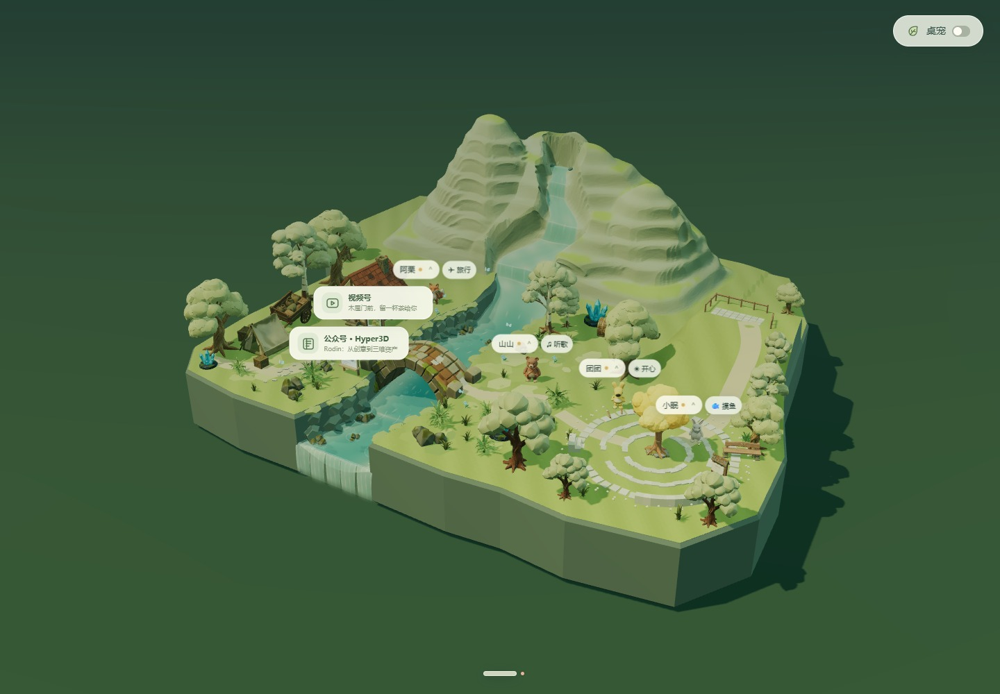

# 山谷资产采用情况 · v1.3.1

历史山谷批次共生成 8 类 Rodin 资产，每类首次提交一次，共消耗 4 credits。当前场景只使用该批次的来信树灯主体、木长椅、告示牌三类。两座旧山已替换为单一连贯山脉，见 [本轮山脉采用与验收](./MOUNTAIN-RANGE-REVIEW.md)；本轮两次 Rodin 生成的实际扣费未由返回结果提供，不计入上述历史费用。

| 资产 | 当前用途 |
| --- | --- |
| 苔岩主峰、层叠山脊 | 已停用、不再加载；保留历史源文件与检查记录 |
| 来信树灯主体 | 木质树干与根；树冠为程序生成的金黄色立体团簇，按好友未读发亮 |
| 木长椅、告示牌 | 广场设施，告示牌可打开聚会邀请 |
| 观景木框 | 按用户要求移除，不再加载 |
| 弧形石坐阶、石环 | 不在当前场景加载；保留付费生成源文件及检查记录，资产查看器仍可访问 |

[任务、参数及 SHA-256](assets/rodin-valley/manifest.json) · [正面检查拼图](validation/rodin-valley/asset-contact.jpg) · [背面检查拼图](validation/rodin-valley/asset-back-contact.jpg)

模型的正面、背面、侧面图仍在 `validation/rodin-valley/`，可用于后续选型和调整；原先过期的场景前后对比图已清理。需比较当前实现时，可运行 `node scripts/test-rodin-valley-browser.mjs` 重新生成同机位对比。

旧 `validation/rodin-valley/geometry.json` 与 `validation/valley-browser.json` 保留各自历史检查。最新山脉、聚会、拖放、八角色、手机与性能证据集中在 `validation/mountain-range/`，以该目录的验收清单和实测时间为准。

生成凭证、订阅密钥和签名下载链接不进入 Git。`records/rodin-valley` 保留本机任务状态，防止续跑时重复付费。已有视频号短片不因本次文件清理而删除。
