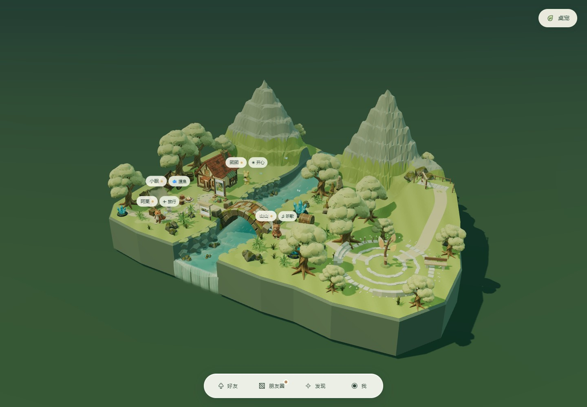
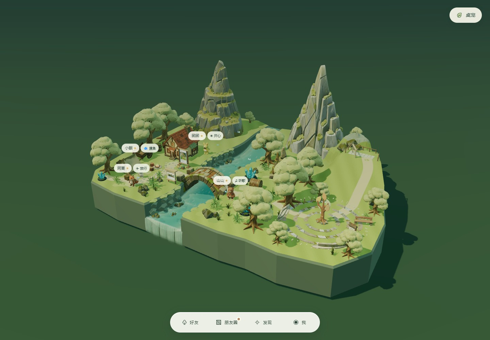
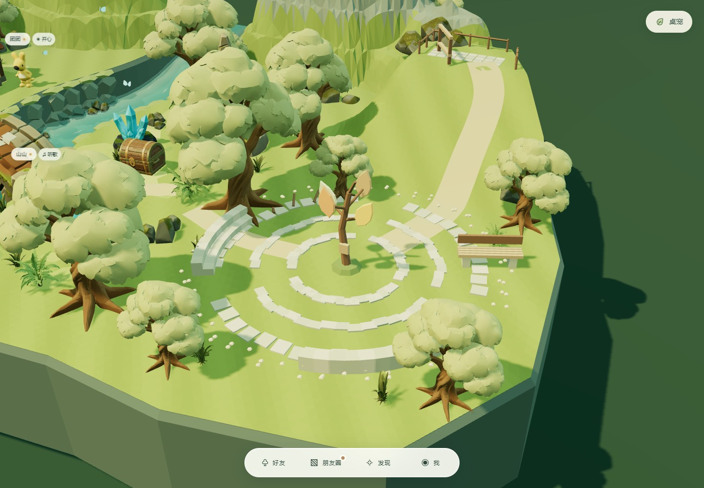
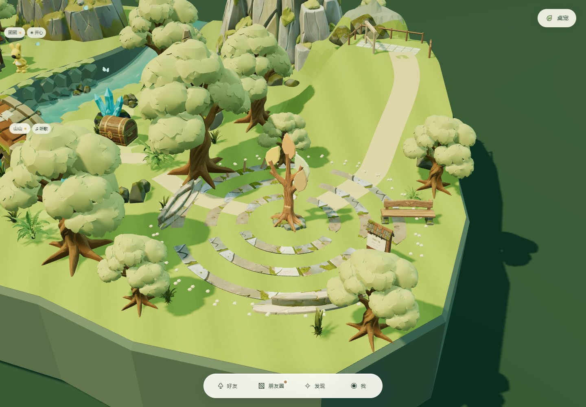

# Rodin 山谷视觉升级 · v1.3.1

最新用户调整：石环、坐阶停用 Rodin 结果并恢复原生几何；树灯改为金黄色立体树冠；观景台护栏旁苔石移除；两座主山进一步增高约 37%。下方记录为初次生成对比，最新画面见 validation/valley-overview.jpg。

本轮按用户要求生成并接入 **8 类资产**，每类首次提交一次，共消耗 **4 credits**。任务均成功，没有追加重生成。凭证仅用于进程运行；公开资产清单不含订阅密钥或签名下载链接。

## 看实际效果

**同机位改造前**（保持此前提亮后的灯光）：



**同机位改造后**：



**广场近景前后**：





## 生成结果与取舍

| 资产 | 实际三角面 | 采用与适配 |
| --- | ---: | --- |
| 苔岩主峰 | 19,146 | 替换西侧规则分层山体；岩面裂缝、苔藓台地与不规则山肩更丰富。底部缩入岛屿边界，并沉入地面消除接缝；按追加要求增高约 12%、加宽约 4% |
| 层叠山脊 | 18,494 | 替换东侧主峰；长条断裂面形成不同轮廓。增高约 12%、加宽约 4%；保留原低山脊、山口泉流和可行走平台 |
| 来信树灯主体 | 11,716 | 替换木干、枝条、根与信箱；四片叶灯继续由程序控制未读，不依赖生成模型的材质分组 |
| 弧形石坐阶 | 8,782 | 两处复用；生成结果更接近小型层叠座台，缩浅后安置在原边缘，避免侵占聚会空位 |
| 林间长椅 | 9,724 | 采用完整木纹、叶形雕饰和苔石脚，维持约 2.5 单位宽的尺度 |
| 苔缝石环 | 5,864 | 结果为较宽半圆而非提示中的小弧段。复用六次，薄化并按世界坐标裁切为三圈石带，保留草缝和三处通路 |
| 森林告示牌 | 11,860 | 新增在广场长椅附近；明确中文内容由本地纹理覆盖，点击打开聚会邀请 |
| 观景木框 | 8,628 | 替换横梁与立柱；保留中空窗口、原取景交互与护栏 |

判断：**山体、木纹家具、灯干与告示牌的细节提升最明显**；石环和坐阶必须做比例及布局适配，不能把生成结果原样堆进场景。模型仍是手绘风格游戏资产，不是精细雕刻或工程级模型。前后图采用相同镜头、同一套提亮后的曝光、四位好友和同一批原有模型，视觉改善不是通过再次提亮造成的。

[来源、任务 ID、参数与 SHA-256](assets/rodin-valley/manifest.json) · [单资产正面检查拼图](validation/rodin-valley/asset-contact.jpg) · [背面检查拼图](validation/rodin-valley/asset-back-contact.jpg)

完整正面、背面、侧面检查图保存在 `validation/rodin-valley/`。开发者可打开 `asset-review.html`，选择新增八个物件进行旋转检查。

## 功能与性能证据

- `validation/rodin-valley/geometry.json`：8 个 GLB 几何有效；两座山的全部采样顶点均位于陆地轮廓内；新灯、长椅、告示牌参与实体碰撞；坡道全宽支撑与平台高度不变。
- `validation/rodin-valley/browser.json`：同机位对比时确认原有资产及全部 8 个新资产均加载；点击告示牌打开邀请，Esc 收起；单独阻断主峰和树灯文件时，回退到原生几何，其他 6 类资产继续可用。
- `validation/valley-browser.json`：四位好友聚会、重复点击、聊天、临时拖动、坡面行走、平台拖放、结束恢复、刷新恢复、未读叶灯、手机旋转和八角色容量通过。
- 本机 Edge / D3D11，1440×1000、DPR 1、四位好友，8 秒稳定段平均 **59.99 FPS**，P95 **16.8ms**，291 次绘制、约 894,100 三角面。该结果仅代表当前电脑测试条件。
- `npm test` 与 `npm run test:launch` 通过；版本、锁文件、构建与一键启动入口为 **1.3.1**。

检查命令：

```powershell
node scripts/audit-rodin-valley.mjs
node scripts/test-rodin-valley-browser.mjs
npm run test:valley
npm test
npm run test:launch
```

旧地形查询、桥河比例、聚会临时数据与既有保存位置保持原语义。生成山体区域仍不可行走，坡道和平台继续使用明确可编辑的地表网格。旧公众号、视频号设施和短片本轮未更换。
