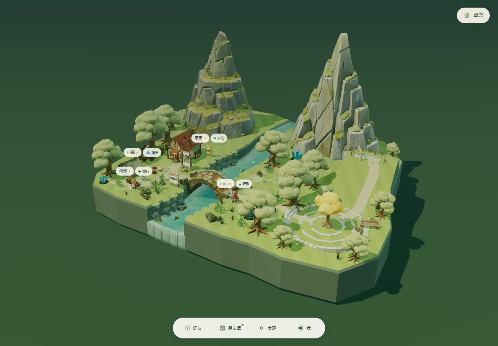

# 山谷资产采用情况 · v1.3.1

共生成 8 类 Rodin 资产，每类首次提交一次，共消耗 4 credits。当前场景使用其中 6 类；石环、坐阶按用户要求停用 Rodin 结果，恢复程序几何。

| 资产 | 当前用途 |
| --- | --- |
| 苔岩主峰、层叠山脊 | 两座主山；左右宽度 16.2 / 16.8，前后厚度 12.45 / 11.55；后侧地形托住山脚 |
| 来信树灯主体 | 木质树干与根；树冠为程序生成的金黄色立体团簇，按好友未读发亮 |
| 木长椅、告示牌、观景木框 | 广场与观景台设施，告示牌可打开聚会邀请 |
| 弧形石坐阶、石环 | 不在当前场景加载；保留付费生成源文件及检查记录，资产查看器仍可访问 |

[任务、参数及 SHA-256](assets/rodin-valley/manifest.json) · [正面检查拼图](validation/rodin-valley/asset-contact.jpg) · [背面检查拼图](validation/rodin-valley/asset-back-contact.jpg)

模型的正面、背面、侧面图仍在 `validation/rodin-valley/`，可用于后续选型和调整；原先过期的场景前后对比图已清理。需比较当前实现时，可运行 `node scripts/test-rodin-valley-browser.mjs` 重新生成同机位对比。

`validation/rodin-valley/geometry.json` 记录实际几何检查；`validation/valley-browser.json` 记录聚会、拖放、刷新、手机、八角色及性能测试。以记录中的实测时间为准，本次历史文件清理未重跑三维验收。

生成凭证、订阅密钥和签名下载链接不进入 Git。`records/rodin-valley` 保留本机任务状态，防止续跑时重复付费。已有视频号短片不因本次文件清理而删除。
