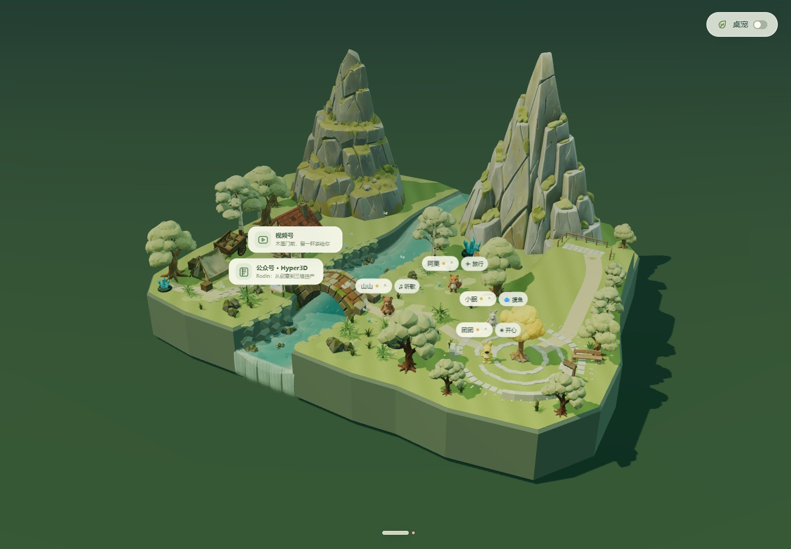
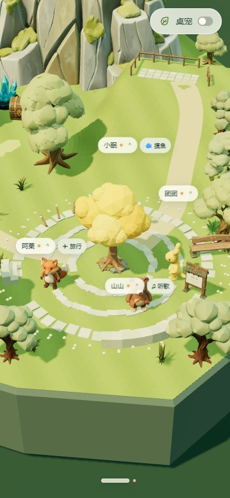

# 第二阶段验证记录

2026-10-16（Asia/Shanghai）。第二阶段 v1.3.1，来源提交 `caea101f3f7746ce9631ed43696d563cb83664d1`。

本次是在第一阶段提交 `7634ca9` 之上提交完整第二阶段快照。原仓库 Git 历史、第三阶段及后续开发代码不导入本仓库。第一阶段仍可从上一提交查看，其来源清单和历史验证记录保留。

## 本次验证

| 检查 | 结果 |
| --- | --- |
| 来源完整性 | 原阶段 486 个文件全部导入；仅 README 增加归档说明，其余 485 个导入文件与来源 SHA-256 一致；Git 对其中 9 个文本文件作行尾标准化，详见来源清单的 `git_normalized_files` |
| 构建 | `npm ci --ignore-scripts --no-audit --no-fund` 与 `npm run build` 成功；三个构建输出与原阶段字节一致 |
| 数据测试 | `npm test` 的社交存储、公共动态、发现数据及桌宠状态测试通过 |
| 在场规则 | `node scripts/test-presence-policy.mjs` 通过：置顶、未读、延迟退出和渐隐反转等 |
| 山谷几何 | `node scripts/test-valley.mjs` 通过：地表、缓坡、平台支撑、碰撞及通行 |
| 浏览器 | `node scripts/test-valley-browser.mjs` 通过：真实树灯点击、邀请、聚会、拖放、聊天相机、散步坡面、四角色观景台、刷新、手机布局与八角色聚会 |
| 浏览器异常 | 本次流程 `pageerror` 为空 |
| 实际画面 | 已查看本次桌面全景和 391×844 手机广场截图 |
| 阶段边界 | 未引入群聊建筑、头像流水线、唱片机、自由漫游、浮岛或性能优化源码 |

原始浏览器结果见 [browser.json](./validation/stage2-20261016/browser.json)。本机 Edge headless、1440×1000、DPR=1、四位好友、8 秒独立采样的平均帧率约 59.6 FPS，P95 帧间隔 17 ms；这只描述本机该场景，不代表其他设备性能。





## 复现

```powershell
npm ci --ignore-scripts --no-audit --no-fund
npm run build
npm test
node scripts/test-presence-policy.mjs
node scripts/test-valley.mjs

# 在单独终端启动测试服务：
$env:FOREST_WEB_PORT='48931'
npm start
# 另一个终端运行：
$env:FOREST_TEST_URL='http://localhost:48931'
$env:FOREST_TEST_OUTPUT='.test-results/stage2'
node scripts/test-valley-browser.mjs
```

保留了原阶段全部源码、资产、来源记录和历史验收资料。`validation/stage2-20261016/` 是本次证据，其他验收文件是来源快照中的历史记录。本次未启动原生 Electron 桌宠、未注册系统协议、未调用付费模型接口；未做全部浏览器流程回归。

Git 行尾标准化只涉及 CRLF/LF，不改变代码内容；清单同时记录这些文件在 Git 中的 SHA-256。原阶段的 `validation/presence/baseline/dist/world.js` 保留了五处历史行尾空白，因此全量 diff 空白检查会报告它；本次新增归档文档的空白检查通过。
