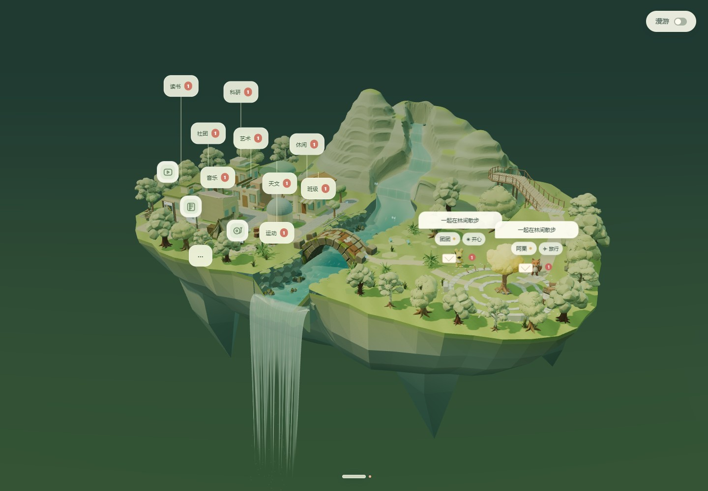
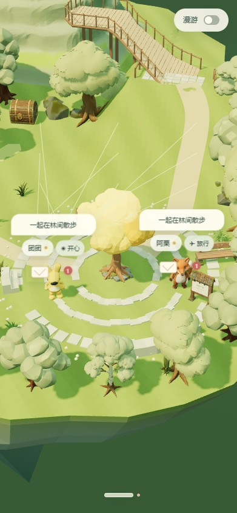

# 第三阶段验证记录

2026-10-16（Asia/Shanghai）。第三阶段版本号沿用产品 v1.3.1，在第二阶段提交 `bd4ad128454b6f701a09d6919b3b4f1f1ae9416c` 上追加完整功能与最新场景快照。

## 来源与交付

来源为 `letters-from-the-woods` 的 `main` 基线 `3b5d33645a6cb68f1ecfee51ab550c60fc684ed1`，加上用户确认的本地树林布局实现。当前原项目的植被修改尚未提交，因此本阶段是明确记录文件散列的工作目录快照，不声称等同于某个原项目历史提交。

共导入 956 个来源文件（约 483.69 MiB），其中 README 增加阶段归档说明并修改下载链接，其余 955 个导入文件的工作目录 SHA-256 与来源一致。重新构建的三个 JS 输出也与来源一致。`SOURCE-MANIFEST.json` 记录逐文件来源散列、基线、修改及未跟踪文件列表，并记录暂存到 Git 的内容散列与行尾标准化差异。

原项目 Git 历史未导入；前两阶段提交、验证文档及证据保留。第二阶段来源清单另存为 `SOURCE-MANIFEST-STAGE2.json`。本机 AGENTS 指令、凭据、运行数据、依赖及缓存未导入。

第三阶段包括头像流水线、群聊和九类建筑、临河小镇、连续山脉、浮岛瀑布、山腰平台、唱片机与声音设置、自由漫游、桌宠设置整合、构建与渲染优化，以及 24 棵森林树、6 棵街树的新布局。装饰晶体已全部移除，陆地装饰苔石只保留 2 处。

## 在本归档仓库重新执行的检查

| 检查 | 结果 |
| --- | --- |
| 依赖与构建 | `npm ci --ignore-scripts --no-audit --no-fund`、`npm run build` 成功 |
| 基础数据 | `npm test` 四组测试通过 |
| 性能实现 | `npm run test:performance`：构建缓存、静态 HTTP 语义、静态变换及碰撞缓存检查通过 |
| 树林与地面 | `npm run test:forest`：24+6 棵树、两处苔石、无晶体；真实/备用根部贴地、无越界或地块侵入；515 个道路采样点和广场入口/坡道通过 |
| 精确地表索引 | 真实/备用山体共 932 个高度采样与原射线一致；变换、正反面和绘制范围检查通过 |
| 群聊数据 | `node scripts/test-group-chat.mjs`：最近九群、稳定位置、候场替换、群资料、@、去重及持久化检查通过 |
| 头像流水线 | `node scripts/test-avatar-pipeline.mjs`：模拟客户端与模拟上传/下载下的去重、恢复、接口隔离及本地保存检查通过；未调用付费服务 |
| 树林浏览器 | `test-forest-browser.mjs`：正常与强制模型失败模式均完整加载；数量、碰撞布局、晶体请求清除、两位角色聚会、九类建筑、桌面/手机截图通过 |
| 性能浏览器 | `test-performance-browser.mjs`：建筑按需加载和共享请求、失败回退、自由漫游、隐藏暂停、录制及视频解码通过 |
| 山谷浏览器 | `test-valley-browser.mjs` 重试通过：真实树灯点击、邀请、4 人聚会、聊天镜头、坡面散步、平台拖放、刷新、手机及 8 人聚会通过 |

浏览器记录见 [树林检查](./validation/stage3-20261016/forest-browser.json)、[性能功能检查](./validation/stage3-20261016/performance-browser.json)、[山谷检查](./validation/stage3-20261016/valley-retry/valley-browser.json)。成功流程均无 `pageerror`。山谷首轮在点击树灯时进入了好友聊天窗口，等待邀请超时；截图已保留为 `valley-first-attempt.jpg`，原脚本不修改，第二轮完整通过。这说明该坐标点击测试存在受随机角色站位影响的偶发失败，不将首轮结果记作通过。

本次四位角色聚会、Edge headless D3D11、1440×1000、DPR=1、约 8 秒采样平均帧率约 60 FPS，P95 帧间隔约 16.8 ms。未在本次归档重复运行完整加载时间基准；此前来源仓库的性能比较仍见 `FOREST-LAYOUT-REVIEW.md`，不作为本次新测结果。

## 实际画面与边界

已查看归档仓库本次生成的九栋建筑桌面全景和 391×844 手机广场截图。





本次未启动 Electron 原生桌宠、未注册系统协议、未调用真实头像生成或付费接口，未进行全套浏览器回归或真实手机硬件测试。产品仍采用本机 IndexedDB，不提供真人多人通信服务。

`validation/stage3-20261016/` 为本次归档验证证据；其他材料保留来源版本的历史记录。因测试会更新历史路径中的报告，本次把新几何报告独立保存，并恢复导入报告的来源字节，避免将历史证据冒充本次验证。

## 复现

```powershell
npm ci --ignore-scripts --no-audit --no-fund
npm run build
npm test
npm run test:performance
npm run test:forest
node scripts/test-group-chat.mjs
node scripts/test-avatar-pipeline.mjs
$env:FOREST_WEB_PORT='48945'
npm start
```

另开终端：

```powershell
$env:FOREST_TEST_URL='http://localhost:48945'
$env:FOREST_TEST_OUTPUT='.test-results/stage3'
npm run test:forest:browser
node scripts/test-performance-browser.mjs
node scripts/test-valley-browser.mjs
```
