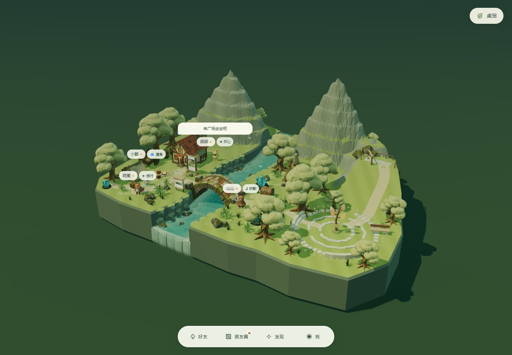

# 山谷会客厅 · v1.3.0 验收

## 打开与体验

双击根目录 **启动林间来信.cmd**，或打开正在运行的 http://localhost:8080/ 。点击右侧广场中央的四叶树灯，再点「来广场坐坐」。点击人物聊天；按住人物可拖到山路和观景台。再次点击树灯选择「结束聚会」，恢复原位置和镜头。点击观景台木框进入回望视角。



[完整操作录像](validation/valley-tour.webm) 包含全景、真实树灯点击、召集、临时拖放、坡道散步、观景台、结束恢复，以及后续容量与手机验证。测试使用独立浏览器上下文，没有清除或改写正在使用的浏览器数据。

## 需求 → 实现 → 验证证据

| 需求 | 实现 | 验证与证据 |
| --- | --- | --- |
| 1.9–2.1 倍地形 | `world-surface.js` 定义两岸连续轮廓；`terrain.js` 在同一表面细分并赋高，外缘补齐岩壁 | `valley-geometry.json`：566.4736 → 1186.0957，**2.093823×**；按草地顶面 XZ 投影多边形面积计算 |
| 原溪谷布局保持 | `layout.js` 原有道具位置未改；发现设施仍在木屋前 | `discovery-placement.json` 记录两处设施坐标与零包围盒穿插；`valley-bridge-audit.json` 双向桥面与桥下通道通过 |
| 两峰、山脊与山口泉流 | 原生分层高度网格，灰绿岩层和苔藓台地；复用树、苔石与蕨草 | `valley-overview.jpg`；峰顶约 14 / 16，河道从 z=-23 接到原有上游；`river-geometry.json` 保留桥下 0.22 水位、河宽和瀑布连接 |
| 年轮广场 | 三道错缝、留出口的石环，草缝与树根；两组坐阶、长椅、低花丛；约 4 单位高四叶树灯 | `valley-plaza.jpg`、`valley-invitation.jpg`；石环等静态细节合批，花丛实例化 |
| 未读叶灯 | 四片叶灯分别映射四位好友，按未读状态常亮 | `valley-browser.json` 检查接收消息后增强发光、标记已读后恢复；没有额外闪烁 |
| 地表查询与多高度拖放 | `querySurface()` 返回 height / normal / region / walkable；真实地表射线拾取，13 点脚底支撑，实体按当前脚底至头顶的高度范围裁剪碰撞 | 主坡道 **21.1007°**，查询与网格独立射线最大误差 **0.01178**；山体、悬崖、灯柱、抬高后的护栏拒绝放置 |
| 坡面散步 | 路径边检查相邻高度及完整支撑；每帧按地表插值脚底高度；人物直立，脚下标记随坡面法线 | `valley-browser.json` 连续 6 秒采样确认脚底贴地、区域可行走且人物确有移动；`valley-ramp.jpg` |
| 四位好友到观景台 | 平台约 y=5.5，缓坡连到广场；完整身体支撑与相互净距检查 | 四位不同体型的实际模型逐一用鼠标拖入平台；`valley-terrace-four-friends.jpg`、JSON 中记录四个位置 |
| 取景框与返回 | 木框点击触发固定回望视角；退出恢复旧镜头 | `valley-terrace-view.jpg`。为越过保留的树冠，回望相机抬至 y=17，手机 y=30；平台本身仍约 y=5.5 |
| 聚会不覆盖原位 | `social-characters.js` 内存快照隔离原站位、当时实际位置与散步状态；聚会拖放跳过存储提交 | 真实树灯点击与邀请按钮、重复召集、外点收起不结束、聊天、临时拖动、结束按钮、坐标与相机逐项恢复、刷新回原位置均通过 |
| 八位可见角色容量 | 同一组已有角色复用，按真实体型检查召集空位 | `?stress=1`：8 个角色召集、逐个实体检查、结束后仍为 8 个；不生成副本 |
| 原有 x/z 数据兼容 | 数据库版本不变；加载按地表重新计算 y；存储坐标校验采用实际世界轮廓 | 原平地位置恢复，抬高位置持久化后刷新正确；`character-drag.json` 含触摸、取消、失败回退、旧聊天点击 |
| 相机与前端交互 | 平移范围从扩展边界约束；快速聚焦前收束前一段镜头动画；四个底部入口保持 | `pan-bounds.json` 极端平移、缩放、手机、发现与聊天往返；`one-click-browser.json` 窗口进出、阅读位置、评论草稿、视频暂停意愿和快速切换通过 |
| 手机与减少动态 | 手机更高俯视角、独立广场与回望构图；浮层按视口夹取；减少动态直接到达静态结果 | `valley-mobile.jpg`、`valley-mobile-plaza.jpg`、`valley-mobile-invitation.jpg`；391×844 及旋转检查，无横向溢出 |
| 30 FPS 目标 | 静态石环合批、花丛实例化；复用 GLB 共享几何材质；山体原生低复杂度网格 | `valley-browser.json`：本机 Edge / D3D11、1440×1000、DPR 1、4 位好友，8 秒稳定段平均约 **60 FPS**，P95 约 **16.8ms**，约 292 draw calls、764k 三角形；不外推到其他设备 |
| v1.3.0 与启动一致 | package / lock / 网页与桌宠元数据 / 构建资源 / README | `launch.json` 检查双击入口、自动构建、版本一致、当前场景资源与视频范围请求 |

## 检查命令

```powershell
npm run build
npm test
npm run test:valley
npm run test:drag
npm run test:placement
npm run test:camera
npm run test:boards
npm run test:anchors
npm run audit:discovery
node scripts/test-river.mjs
node scripts/audit-bridge.mjs --out validation/valley-bridge-audit.json
npm run test:launch
```

没有新增付费模型、多人通信或全地图集合寻路。山峰只作景观；聚会通过叶片转场抵达，散步仍使用各自附近的小范围安全路径。视频号原有短片保持此前录制版本。桌宠独立窗口本轮未作功能改动，启动入口已回归验证。
