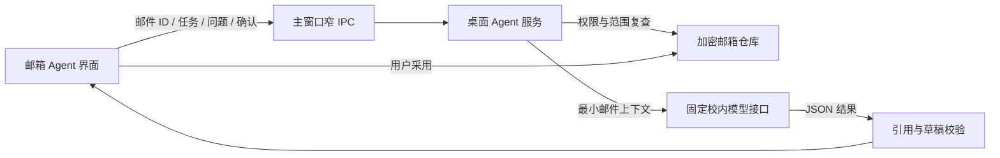

# WeRoam 邮箱 Agent

版本：v0.1 beta。更新日期：2026-10-18。

## 能做什么

桌面端连接 QQ 或 163 邮箱后，可选择邮件并向“邮箱 Agent”提问，或使用“摘要、待办、写回复”。分类通过对话提出。回答显示来源，生成的回复只有点击“采用”后才保存为本地草稿。

本版不发送、删除或修改远端邮件，不读取附件。所有草稿均为“尚未发送”；可编辑、复制并返回原邮箱处理。普通网页和 Android 保留本地演示，不借助网页访问桌面邮箱或模型密钥。

## 使用

1. 运行 `npm run desktop` 启动桌面版；已经打开的旧版需重启以加载主进程与桥接更新。在桌面版连接邮箱并收取邮件。授权码只在本地邮箱连接窗口填写。
2. 打开“邮箱 Agent”，选择 1–10 封邮件。首次使用连接时开启“AI 处理”和“校内 AI”两项权限。
3. 输入问题或选择快捷任务，确认允许校内 AI 处理本次选择后开始。可随时停止。
4. 点击来源返回对应邮件；点击“采用”保存候选草稿，再自行编辑。采用不代表发送。
5. 不再使用时可在连接权限中撤销 AI 权限；断开邮箱会删除该连接的本地邮件、草稿与派生数据。

仅向校内服务发送所选邮件的主题、发件人、时间、正文、必要标识和用户问题。同一选择范围的后续对话还会附带有限的本轮历史。授权码、附件及未选邮件不会进入请求。AI 回答需由用户核实，来源校验不能保证回答每个判断都正确。

## 本地配置

将 `desktop/agent-config.example.cjs` 复制到 `.weroam-private/agent-config.cjs`，仅在私有文件中设置 `apiKey`。该目录已加入 Git 忽略；前端、文档与日志不包含真实凭据。已经配置的本机可直接使用，无需重复输入。

服务固定使用 HTTPS 校验证书、Bearer 认证和以下接口，不接受 UI 自定义地址：

```text
POST https://genaiapi.shanghaitech.edu.cn/api/v1/start/chat/completions
model: deepseek-pro
stream: false
max_tokens: 2000
```

不使用 Response 协议，不执行自动重试。缺少配置、认证失败、限流、网络错误、超时或输出无法校验时均显示错误，不生成伪成功结果。

## 技术边界



- `agent-request` 只接受可信本地主窗口的主 frame。支持 `status`、`run`、`cancel`、`clear`，不提供任意 HTTP、代码执行或邮箱协议工具。
- `run({runId, sessionId, threadIds, task, prompt, consent})` 的任务为 `ask / summary / classify / todos / reply`。`consent` 必须为 `true`，问题最多 2,000 字符，同一会话只能运行一个请求。
- 权限为连接级 `ai.process` 与 `ai.export.cloud`，两项同时满足才可处理；每次请求另需确认。旧缓存缺少这些字段时默认关闭。普通读取权限不隐含云端处理权限。
- 每次最多 10 封，正文合计最多 40,000 字符，超过后拒绝并提示缩小范围。响应上限 2,000 tokens，60 秒超时；不静默截断邮件。
- 结果只有回答、所选来源引用、候选草稿。引用须为所选正文的连续原文；未知邮件、伪造引用、超限内容或越权草稿会使整次结果失败。草稿收件人由可信邮件发件人确定，模型不能指定其他收件人。
- 邮件内容是不可信资料，模型没有外发工具。提示注入仍可能影响自然语言质量，但无法通过本功能发送、删除、联网或执行代码。
- 撤销、断开或选定邮件变化会取消任务并清除关联会话；迟到响应不能重新写回。关闭助手、主页面导航或窗口销毁会清除内存对话。关闭不会取消已经采用的本地草稿。
- 采用的草稿与权限保存在原桌面加密仓库；真实内容不进入演示 IndexedDB。审计记录类型、时间、数量和结果，不记录正文、用户问题、回答或密钥。
- 加密依赖 Electron `safeStorage`；无法使用时拒绝保存真实邮箱。操作系统当前用户下的恶意进程不在该加密的防护范围内。

## 验证与支持范围

本次自动化测试使用合成邮件、临时加密仓库和模拟模型响应，不读取用户真实邮件。QQ 邮箱此前有用户反馈连接成功；163 接入实现存在，但尚未完成真实账号验收。模型接口的探针与真实邮件验收状态见 [验证记录](MAIL-AGENT-VALIDATION.md)。

运行：

```powershell
npm run test:mail:agent
npm run test:mail:agent:browser
npm run test:mail:agent:desktop
```

可选运行 `npm run agent:probe` 检查真实模型接口；只发送无隐私的 OK 探针。`node scripts/probe-mail-agent.mjs --structured` 使用合成邮件检查结构化输出。这两条命令会请求校内服务，其余上述测试使用模拟响应，不提交真实邮件。
