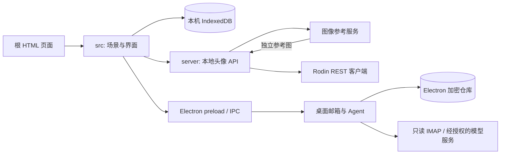

# 项目结构与职责

[项目首页](../README.md) / [文档索引](README.md)

WeRoam 使用原生 JavaScript ES Modules 构建共享三维前端。Node 本地服务、Electron 桌面能力及 Android 容器提供各平台特有功能；三者不共享所有权限或用户数据。

## 顶层目录

| 路径 | 职责 | 维护边界 |
| --- | --- | --- |
| 根目录 HTML | 主世界、桌宠、模型/骨骼查看和数据传递页面 | 稳定路由入口；不承载共享业务实现 |
| `src/` | Three.js 场景、角色、前端状态和 UI | 浏览器共享代码；通过适配器使用平台能力 |
| `server/` | 本地头像 API、生成任务、REST 客户端与静态文件服务 | 不将私有配置返回浏览器 |
| `desktop/` | Electron 主进程、preload、桌宠、邮箱与 Agent | 凭据在可信执行端；窄 IPC |
| `android/` | Java WebView 容器、Gradle 与原生测试 | Android 生命周期、系统选图及平台桥接 |
| `mobile/` | Android WebView 前端桥接与样式 | `android-runtime.js` 与 `android.css`，由 Android 资源构建打包 |
| `assets/` | 运行所需模型、图片、音视频及资产来源记录 | 第三方权利单独处理，不继承根许可证 |
| `config/` | 图片与 Rodin 本机配置模板 | 仅占位值；复制到私有目录后填写，运行时不读取模板 |
| `scripts/` | 构建、启动、打包、诊断、录制与基准工具 | 不作为业务模块目录 |
| `tests/` | 逻辑、浏览器、平台及契约验证 | 从 npm 脚本运行；使用合成数据和模拟供应商 |
| `docs/` | 开发、架构、功能与证据说明 | 导航见 [docs/README](README.md) |
| `dist/` | esbuild 生成的浏览器 bundle | 可重建、Git 忽略；启动前构建 |
| `weroam-slides/` | 演示材料与其构建资源（本机如有） | 不属于应用启动依赖；素材许可独立核对 |

## 前端目录

```text
src/
├── main.js / startup.js # 主应用与启动界面
├── scenes/
│   ├── forest/          # 森林、山谷、溪流与地形
│   ├── fuji/            # 富士、樱花街区与列车
│   ├── ideal/           # 理想城布局与场景
│   └── shared/          # 场景共享布局、自然及建筑组件
├── characters/          # 模型、骨骼、动作、拖动、桌宠与 Worker
├── social/              # 好友、消息、动态、状态与群聊
├── discovery/           # 文章、视频、内容设施与预览
├── rendering/           # 场景资源、几何、静态实例与渲染辅助
├── ui/                  # 界面、控件、主题、相机交互
├── platform/            # 浏览器/移动/WebXR 平台适配
├── audio/               # 音乐、声音与唱片播放
├── review/              # 资产、骨骼与数据查看工具
├── styles/              # 样式表
├── inbox/               # Universal Inbox 模块
└── mods/                # Mod 目录、存储、界面与场景设施
```

按领域归类时保留原有文件名，方便按名称检索和核对历史记录。模块导入使用显式相对路径，同时保留既有的 `window.__*` 运行桥接与诊断接口。新增代码优先沿用明确职责，避免在整理目录时同时重写场景逻辑或改变 URL。

## 应用入口

| 页面 / 执行入口 | 实现位置 |
| --- | --- |
| `index.html` | `src/startup.js` 启动页与 `src/main.js` 三维主应用，主 bundle 为 `dist/world.js` |
| `pet.html` | `src/characters/pet.js` 与 `dist/pet.js` |
| `asset-review.html` | `src/review/asset-review.js` 与 `dist/review.js` |
| `rig-review.html` | `src/review/rig-review.js` 与 `dist/rig-review.js` |
| 骨骼 Worker | `src/characters/character-rig-worker.js` 与 `dist/rig-worker.js` |
| 本地 HTTP | `scripts/serve.mjs`，调用 `server/static-files.mjs` 和 `server/avatar-api.mjs` |
| Electron | `desktop/main.cjs`，经 `desktop/preload.cjs` 暴露受限能力 |
| Android | `android/app/src/main/`，加载打包的本地网页资源 |

`scripts/build.mjs` 使用 esbuild 输出主世界、桌宠、查看器和骨骼 Worker，并单独生成 Inbox / Workshop ESM bundle。构建脚本更新页面版本参数，主页面不通过框架路由替代根 HTML。

## 可信端与数据流



头像生成主要实现位于 `server/avatar-pipeline.mjs`，图像配置由 `server/image-config.mjs` 读取，项目 Rodin 请求统一经过 `server/rodin-rest-client.mjs`。任务恢复时查询已有任务，避免结果不明导致重复提交。

桌面邮箱由 `desktop/mail-service.cjs`、`mail-ipc.cjs`、`mail-providers.cjs` 管理；邮箱 Agent 由 `mail-agent-service.cjs` 与 `agent-provider.cjs` 管理。浏览器和 Android 不自动获得桌面真实邮箱能力。Android 既有头像演示含独立原生生成实现，尚未统一到 Node REST 客户端，详见[开发指南](DEVELOPMENT.md)的配置边界。

## 运行数据与生成物

以下目录不作为开源源代码提交，不要通过通用静态目录直接暴露。

| 路径 / 数据 | 内容 |
| --- | --- |
| `.forest-avatar-data/` | 私有图像/Rodin 配置、订阅凭据、任务状态和本机生成资产 |
| `.weroam-private/` | 邮箱 Agent 本机服务配置 |
| `.forest-runtime.json` | 本机端口等启动状态 |
| `.android-signing/` | Android 签名密钥与签名配置；需独立备份 |
| `.cache/` | 构建指纹、资源清单和本机工具缓存 |
| `.test-results/` | 本机检查结果、截图和临时记录 |
| `dist/`、`downloads/` | 前端 bundle 与安装包输出 |
| `output/`、`records/` | 本机生成、录制与实验产物 |
| Electron userData | 独立加密邮箱数据、桌宠设置等，位于系统应用数据目录 |
| 浏览器 / Android IndexedDB | 各自设备和来源下的会话、草稿与模块状态 |

浏览器、Electron 与手机数据没有自动云同步。备份或重置前应明确所在运行端；删除构建缓存不等于删除消息，卸载应用或清除站点数据则可能删除本机内容。
