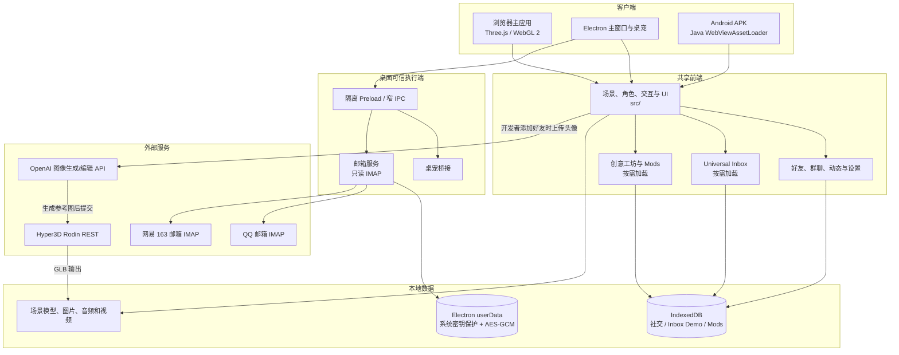

# WeRoam 项目说明

**项目名称：** WeRoam<br>
**版本：** v0.1 beta<br>
**项目口号：** 让每一次聊天，都有一处风景。<br>
**说明版本：** 2026-10-18

## 一、项目简介

WeRoam 是一款以三维空间为社交界面的互动原型。项目希望把好友关系、消息交流、内容浏览和共同活动放进可漫游、可交互的虚拟场景：用户可以在森林、富士樱町和理想城中探索，与好友角色互动、进入群聊空间，并通过场景中的设施打开音乐、文章和视频等内容。

项目同时探索跨平台信息归集与用户创作扩展。Universal Inbox 将本地社交会话、演示消息和受支持的邮箱连接纳入统一消息工作区；创意工坊以 Mod 管理内容模块；Android 版本将主要体验带到手机，WebXR 则提供兼容头显中的三维场景浏览方式。

当前交付是持续开发中的产品原型，不代表已经接通所有社交平台，也不代表完整的 VR 社交服务。微信、QQ 社交消息、抖音和小红书等账号的完整私信接入不属于当前已验证能力。

## 二、成员信息

已确认的项目成员及联系方式如下。

| 序号 | 姓名   | 联系方式                       |
| ---- | ------ | ------------------------------ |
| 1    | 宋梓冬 | songzd2024@shanghaitech.edu.cn |
| 2    | 周博扬 | zhouby2024@shanghaitech.edu.cn |

## 三、功能说明

### 1. 三维社交场景

- **林间来信、富士樱町、理想城：** 三个可切换的三维场景，支持昼夜变化、视角控制和场景漫游。
- **好友角色与互动：** 好友以三维形象出现在场景中；通讯录区分好友所属平台。上传头像后可沿项目现有流程生成三维角色。角色可拖动、漫游，并通过场景标签进入对应会话。
- **群聊空间：** 群聊与场景中的群组建筑关联，用户可从建筑进入对应群组消息。
- **场景交互：** 森林音乐设施、理想城飞艇、樱町列车等物件提供相应的内容或跟随视角入口。理想城不包含会客厅。

### 2. Universal Inbox

- 汇集本地好友、群聊、合成演示消息及用户手动收录的内容，并标示来源。
- 提供连接与权限演示、来源筛选、待跟进状态、消息搜索、摘要和回复草稿流程。
- 浏览器演示使用本地合成数据、手动收录和脚本化 Agent；模拟发送只写入演示数据，不代表消息已送达外部平台。
- Windows 桌面端另提供 QQ 邮箱及网易 163 邮箱的只读 IMAP 连接实现，凭据在独立本地窗口输入，邮件加密保存在本机。QQ 连接曾由用户在本地确认成功；163 代码已接入但尚未进行真实账号授权。邮箱功能不提供发送或远端修改。
- 桌面“邮箱 Agent”通过校内 `deepseek-pro` 接口处理用户选定并单独授权的邮件，支持对话、摘要、待办、分类及回复草稿；不发送或修改远端邮件。普通网页和 Android 保留本地演示。
- 当前没有微信个人号、QQ 个人聊天、抖音、小红书的完整消息 API 接入。

### 3. 创意工坊与 Mod

- 朋友圈、公众号、视频号以随应用提供的已安装模块形式运行；便签和专注计时器可在工坊中安装。
- 已安装模块支持启用、停用、固定、卸载和数据清除等管理操作；便签及工坊状态保存在本机。
- 公众号或视频号模块停用时，场景内对应设施与交互入口同步隐藏。
- 当前工坊目录随应用发布，不下载或执行第三方社区代码；安装模块不等于连接对应平台账号。

### 4. 桌面、手机与 VR

- **浏览器：** 通过 HTML、CSS、JavaScript 和 Three.js 运行三维主应用。
- **Windows 桌面：** 使用 Electron 提供桌面容器及独立桌宠能力；桌宠属于单独窗口，不等于跨平台在线服务。
- **Android：** 提供可安装 APK，支持三个场景、触控操作、消息与本地数据。Android 收件箱目前为演示／手动数据模式，不与桌面邮箱账户自动同步。
- **WebXR：** 在具备 WebXR 能力的头显浏览器中请求 VR 会话并观察三维场景。模拟测试覆盖会话流程；项目记录未将其作为 PICO 等实体头显的完整实机验收。

## 四、技术与实现概览

项目采用原生 JavaScript、Three.js、WebGL 2、esbuild、Node.js 和 IndexedDB；桌面端采用 Electron，Android 端采用 Java、WebViewAssetLoader 与 Gradle。场景资产以 glTF／GLB 等格式加载，前端与三维场景在浏览器、桌面和 Android 容器中复用。

头像转三维角色流程由用户提供头像开始，使用图像生成服务制作全身形象参考，再通过 Hyper3D Rodin 生成三维模型并接入场景。模型生成服务和相关软件属于第三方工具；其输出经项目导入和集成，不应表述为团队从零开发了这些服务或底层模型。

## 五、原创声明

本人／本团队声明：本项目的产品方案、交互流程、应用代码、场景组织方式、模块管理逻辑及相关文档由项目成员围绕 WeRoam 原型设计、实现或整理。演示文稿中的产品定位、功能架构和体验流程用于说明本项目，不表示未实现的平台接入已经完成。

项目使用 Three.js、Electron、Node.js、Android 工具链及其他开源依赖，并在头像形象与三维模型制作中使用第三方生成服务。平台品牌图标、第三方软件标识、用户提供素材及生成工具输出不主张为项目团队原创；相关权利归原作者或权利人所有。引用、授权、开源许可及生成素材的使用应遵守各自条款。成员应在提交前核对项目内素材来源记录，并补充未记录的来源或授权信息。

本声明仅用于说明本项目的创作与使用边界，不替代赛事要求的原创性审查、软件著作权登记或第三方授权证明。请团队确认成员贡献和素材来源后签署。

**团队负责人签名：** ____________________<br>
**团队成员签名：** ____________________<br>
**日期：** ______年____月____日

## 六、参考材料

- 项目概览与运行入口：[README.md](../README.md)
- 技术实现：[TECHNICAL-ARCHITECTURE.md](TECHNICAL-ARCHITECTURE.md)
- 第三方资源与授权状态：[THIRD-PARTY-RESOURCES.md](THIRD-PARTY-RESOURCES.md)
- Universal Inbox 能力与边界：[UNIVERSAL-INBOX.md](UNIVERSAL-INBOX.md)、[MAIL-INTEGRATION.md](MAIL-INTEGRATION.md)
- 邮箱 Agent 使用与验证：[MAIL-AGENT.md](MAIL-AGENT.md)、[MAIL-AGENT-VALIDATION.md](MAIL-AGENT-VALIDATION.md)
- 创意工坊与 Mod：[WORKSHOP.md](WORKSHOP.md)
- Android 演示版：[ANDROID.md](ANDROID.md)
- WebXR 范围：[PICO-VR.md](PICO-VR.md)
- 演示文稿：`weroam-slides/output/WeRoam-v27.pptx`（17 页）

---

# WeRoam 技术实现说明

**项目版本：** v0.1 beta<br>
**代码核对日期：** 2026-10-18

本文按当前仓库实现编写。演示稿中的愿景、方案图和平台接入设想不自动代表代码已实现；功能边界以代码和项目记录为准。

## 1. 系统结构



普通浏览器和 Android 使用本地演示／手动消息数据。Windows Electron 另有隔离的邮箱连接窗口和 IMAP 执行端；真实邮箱内容不写入浏览器的 Inbox Demo IndexedDB。头像生成属于另外的付费服务流程，不是载入示例消息时触发。

## 2. 技术栈与源码分层

| 部分          | 当前实现                                                     |
| ------------- | ------------------------------------------------------------ |
| 前端          | 原生 JavaScript ES Modules、HTML、CSS；不使用 React/Vue 等 UI 框架 |
| 三维          | Three.js 0.180、WebGL 2、GLTFLoader；场景根、渲染器和角色资源在场景生命周期内复用 |
| 构建          | esbuild 0.25；`scripts/build.mjs` 维护输入指纹缓存，并把主世界、Inbox、Workshop 分成独立 bundle |
| 本地 Web 服务 | Node.js 22+；`scripts/serve.mjs` 与 `server/static-files.mjs` 提供静态资源，头像 API 由 `server/avatar-api.mjs` 和 `server/avatar-pipeline.mjs` 处理 |
| 桌面端        | Electron 36；`desktop/main.cjs` 在主进程管理窗口，`desktop/preload.cjs` 暴露有限 IPC；邮箱凭据页使用独立 preload |
| Android       | Java、Android WebView、AndroidX WebKit `WebViewAssetLoader`；网页与场景资源打包至 APK，离线加载，不请求电脑 localhost |
| 存储          | 社交会话和内容、Inbox 演示库、Mods 数据使用各自的 IndexedDB；Electron 真实邮箱使用 userData 下的独立加密文件 |
| VR            | WebXR `immersive-vr` 与 `local-floor`；复用现有 renderer/scene，不创建第二个世界 |

主要代码入口：

- 三维主应用与渲染循环：`src/main.js`、`src/scenes/shared/scene-world.js`、`src/scenes/shared/scene-assets.js`
- 三场景与布局：`src/scenes/forest/`、`src/scenes/fuji/`、`src/scenes/cyber/`、`src/scenes/ideal/`；共享组件在 `src/scenes/shared/`
- 角色、骨骼与状态动作：`src/characters/social-characters.js`、`src/characters/character-rig.js`、`src/characters/character-actions.js`、`src/characters/character-rig-worker.js`
- 社交数据及界面：`src/social/social-store.js`、`src/social/social-conversations.js`、`src/social/social-ui.js`
- Inbox：`src/inbox/`，与主场景和演示库通过适配层连接；桌面邮箱另位于 `desktop/mail-*.cjs` 与 `src/inbox/desktop-mail.js`
- Mods：`src/mods/`，由 `src/main.js` 的模块管理器加载
- 头像生成：`server/image-config.mjs`、`server/rodin-rest-client.mjs`、`server/avatar-pipeline.mjs`
- Android 原生容器：`android/app/src/main/`

## 3. 运行与数据流

### 场景启动与资源

主页面启动 Three.js 场景及必要运行资源。构建脚本为主世界、审查工具、桌宠、骨骼 Worker 等生成 bundle；Inbox 与 Workshop 采用独立 ESM bundle，用户打开对应界面时再加载。场景 GLB、图片、音频和视频从本地资源目录读取，Android 构建按白名单复制运行资源。

场景通过共享的世界管理和资源缓存切换。好友状态、消息、群聊、动态和 Mod 状态分别由本地模块读写；场景对象和面板从这些状态投影，不是远端社交账号的实时镜像。

### Inbox 与邮箱

浏览器 Inbox 由 Connector/Gateway、权限和审批逻辑以及独立 Demo 存储组成。演示连接和模拟发送只作用于本机数据；手动导入会保留来源标签。没有浏览器 Agent 的任意联网或真实社交发送接口。

Electron 邮箱服务只连接固定的 QQ／163 IMAP 主机，使用只读 EXAMINE，限制收取范围并在本机加密保存。主窗口不能读取授权码；主进程校验授权窗口和 frame 后接收凭据。应用不启用 SMTP、不发送邮件、不修改服务端已读状态。

桌面邮箱 Agent 通过窄 IPC 接收邮件 ID、任务与用户问题，在可信执行端复核双授权及本次确认后，调用固定校内 `deepseek-pro` 接口。所选邮件正文总计不超过 40,000 字符、最多 10 封；返回纯文本回答、精确来源引用及待采用草稿。会话仅存内存，采用的草稿沿用邮箱加密仓库；撤销或内容变化取消请求并丢弃迟到结果。见[邮箱 Agent 说明](MAIL-AGENT.md)。

### 头像生成

用户主动添加好友并上传有权使用的头像后，服务端先调用图像编辑服务生成单独参考图，再通过 `server/rodin-rest-client.mjs` 提交 Hyper3D Rodin，查询原任务并下载 GLB。任务记录用于避免网络结果不明时重复提交。Rodin API 凭据从项目私有配置读取，不能写进源码、普通日志或文档。

Android 源码包含独立头像生成演示实现。当前标准构建不注入开发者密钥，用户在手机模型服务设置中配置自己的密钥，由 Android Keystore 与 AES-GCM 加密保存。原生演示尚未统一到项目指定的 Node REST 客户端与项目私有配置入口；详见 [Android 头像说明](ANDROID-AVATAR-DEMO.md)。后续维护与新增 Rodin 请求须遵守 `AGENTS.md` 的统一入口约束。

## 4. 信任与数据边界

- 浏览器中的权限流程用于产品演示，不能保护对本地 JavaScript 或开发者工具有控制权的用户。
- 桌面邮箱凭据留在 Electron 执行端及本机加密文件；前端得到消息投影。用户完成独立 AI 权限及逐次确认后，所选邮件的必要文本可发送给固定校内模型服务；授权码和附件不进入模型请求。
- Android 的 IndexedDB/本机数据与桌面及浏览器数据互不自动同步。
- 邮件授权码可能拥有平台授予的读写范围；WeRoam 当前只执行读取，不等同于邮箱平台只发放只读凭据。
- 图片和头像上传到第三方生成服务前，上传者应确认自己有权提供输入，并遵循相关服务条款。
- 场景、模型和内容素材随应用分发；其来源与许可状态详见[第三方资源与授权说明](THIRD-PARTY-RESOURCES.md)。

## 5. 代码内可复核的验证入口

测试脚本按功能位于 `tests/`，构建与诊断工具位于 `scripts/`。常用命令包括：

```powershell
npm run build
npm test
npm run test:inbox
npm run test:mods
npm run test:android
npm run test:webxr
npm run test:performance
```

这些命令覆盖构建、存储、Inbox 权限逻辑、Mod 状态、Android WebView 资源和 WebXR 模拟流程；模拟器或浏览器测试不能替代每款实体手机、PICO 头显、平台账号或素材权属的实测。
