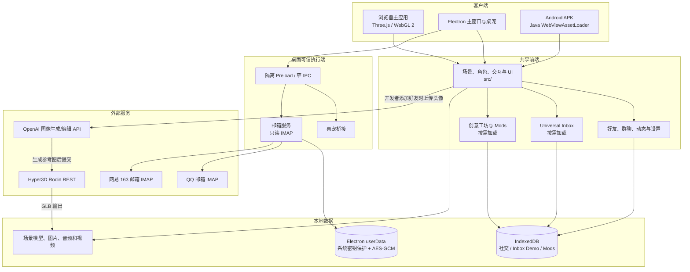

# WeRoam 技术实现说明

[项目首页](../README.md) / [文档索引](README.md)

**项目版本：** v0.1 beta<br>
**代码核对日期：** 2026-10-18<br>
**工程结构与配置说明更新：** 2026-10-19

本文按当前仓库实现编写。演示稿中的愿景、方案图和平台接入设想不自动代表代码已实现；功能边界以代码和项目记录为准。

## 1. 系统结构



普通浏览器和 Android 使用本地演示／手动消息数据。Windows Electron 另有隔离的邮箱连接窗口和 IMAP 执行端；真实邮箱内容不写入浏览器的 Inbox Demo IndexedDB。头像生成属于另外的付费服务流程，不是载入示例消息时触发。

## 2. 技术栈与源码分层

| 部分 | 当前实现 |
| --- | --- |
| 前端 | 原生 JavaScript ES Modules、HTML、CSS；不使用 React/Vue 等 UI 框架 |
| 三维 | Three.js 0.180、WebGL 2、GLTFLoader；场景根、渲染器和角色资源在场景生命周期内复用 |
| 构建 | esbuild 0.25；`scripts/build.mjs` 维护输入指纹缓存，并把主世界、Inbox、Workshop 分成独立 bundle |
| 本地 Web 服务 | Node.js 22+；`scripts/serve.mjs` 与 `server/static-files.mjs` 提供静态资源，头像 API 由 `server/avatar-api.mjs` 和 `server/avatar-pipeline.mjs` 处理 |
| 桌面端 | Electron 36；`desktop/main.cjs` 在主进程管理窗口，`desktop/preload.cjs` 暴露有限 IPC；邮箱凭据页使用独立 preload |
| Android | Java、Android WebView、AndroidX WebKit `WebViewAssetLoader`；网页与场景资源打包至 APK，离线加载，不请求电脑 localhost |
| 存储 | 社交会话和内容、Inbox 演示库、Mods 数据使用各自的 IndexedDB；Electron 真实邮箱使用 userData 下的独立加密文件 |
| VR | WebXR `immersive-vr` 与 `local-floor`；复用现有 renderer/scene，不创建第二个世界 |

主要代码入口：

- 三维主应用与渲染循环：`src/main.js`、`src/scenes/shared/scene-world.js`、`src/scenes/shared/scene-assets.js`
- 三场景与布局：`src/scenes/forest/`、`src/scenes/fuji/`、`src/scenes/ideal/`；共享组件在 `src/scenes/shared/`
- 角色、骨骼与状态动作：`src/characters/social-characters.js`、`src/characters/character-rig.js`、`src/characters/character-actions.js`、`src/characters/character-rig-worker.js`
- 社交数据及界面：`src/social/social-store.js`、`src/social/social-conversations.js`、`src/social/social-ui.js`
- Inbox：`src/inbox/`，与主场景和演示库通过适配层连接；桌面邮箱另位于 `desktop/mail-*.cjs` 与 `src/inbox/desktop-mail.js`
- Mods：`src/mods/`，由 `src/main.js` 的模块管理器加载
- 头像生成：`server/image-config.mjs`、`server/rodin-rest-client.mjs`、`server/avatar-pipeline.mjs`
- Android 原生容器：`android/app/src/main/`
- 前端样式：`src/styles/`；前端领域目录见[项目结构](PROJECT-STRUCTURE.md)
- 本地配置模板：`config/`，仅有占位值，运行时使用私有目录内的实际配置

## 3. 运行与数据流

### 场景启动与资源

主页面启动 Three.js 场景及必要运行资源。构建脚本为主世界、审查工具、桌宠、骨骼 Worker 等生成 bundle；Inbox 与 Workshop 采用独立 ESM bundle，用户打开对应界面时再加载。场景 GLB、图片、音频和视频从本地资源目录读取，Android 构建按白名单复制运行资源。

场景通过共享的世界管理和资源缓存切换。好友状态、消息、群聊、动态和 Mod 状态分别由本地模块读写；场景对象和面板从这些状态投影，不是远端社交账号的实时镜像。

### Inbox 与邮箱

浏览器 Inbox 由 Connector/Gateway、权限和审批逻辑以及独立 Demo 存储组成。演示连接和模拟发送只作用于本机数据；手动导入会保留来源标签。没有浏览器 Agent 的任意联网或真实社交发送接口。

Electron 邮箱服务只连接固定的 QQ／163 IMAP 主机，使用只读 EXAMINE，限制收取范围并在本机加密保存。主窗口不能读取授权码；主进程校验授权窗口和 frame 后接收凭据。应用不启用 SMTP、不发送邮件、不修改服务端已读状态。

桌面邮箱 Agent 通过窄 IPC 接收邮件 ID、任务与用户问题，在可信执行端复核双授权及本次确认后，调用固定校内 `deepseek-pro` 接口。所选邮件正文总计不超过 40,000 字符、最多 10 封；返回纯文本回答、精确来源引用及待采用草稿。会话仅存内存，采用的草稿沿用邮箱加密仓库；撤销或内容变化取消请求并丢弃迟到结果。见[邮箱 Agent 说明](MAIL-AGENT.md)。

### 头像生成

用户主动添加好友并上传有权使用的头像后，服务端先调用图像编辑服务生成单独参考图，再通过 `server/rodin-rest-client.mjs` 提交 Hyper3D Rodin，查询原任务并下载 GLB。任务记录用于避免网络结果不明时重复提交。Rodin API 凭据从项目私有配置读取，不能写进源码、普通日志或文档。

Android 源码包含独立头像生成演示实现：用户在手机「我 → 设置 → 模型服务配置」输入自己的服务配置，`AvatarSettings` 使用 Android Keystore 与 AES-GCM 加密保存，`AvatarService` 在原生线程执行图像与 Rodin 请求。当前标准构建不注入开发者密钥。旧的开发者密钥导出工具已移除；公开 APK 不应携带私有配置。

该 Android 实现尚未统一到项目指定的 `server/rodin-rest-client.mjs` 与 `.forest-avatar-data/hyper3d-config.json` 入口，属于既有边界，不能宣称全平台已统一。后续维护与新增 Rodin 请求须遵循 `AGENTS.md` 的统一配置约束。详见 [Android 头像说明](ANDROID-AVATAR-DEMO.md)。

## 4. 信任与数据边界

- 浏览器中的权限流程用于产品演示，不能保护对本地 JavaScript 或开发者工具有控制权的用户。
- 桌面邮箱凭据留在 Electron 执行端及本机加密文件；前端得到消息投影。用户完成独立 AI 权限及逐次确认后，所选邮件的必要文本可发送给固定校内模型服务；授权码和附件不进入模型请求。
- Android 的 IndexedDB/本机数据与桌面及浏览器数据互不自动同步。
- 邮件授权码可能拥有平台授予的读写范围；WeRoam 当前只执行读取，不等同于邮箱平台只发放只读凭据。
- 图片和头像上传到第三方生成服务前，上传者应确认自己有权提供输入，并遵循相关服务条款。
- 场景、模型和内容素材随应用分发；其来源与许可状态详见[第三方资源与授权说明](THIRD-PARTY-RESOURCES.md)。

## 5. 代码内可复核的验证入口

测试脚本按功能位于 `tests/`，构建与诊断工具位于 `scripts/`。常用命令包括：

```powershell
npm run build
npm test
npm run test:inbox
npm run test:mods
npm run test:android
npm run test:webxr
npm run test:performance
```

这些命令覆盖构建、存储、Inbox 权限逻辑、Mod 状态、Android WebView 资源和 WebXR 模拟流程；模拟器或浏览器测试不能替代每款实体手机、PICO 头显、平台账号或素材权属的实测。
