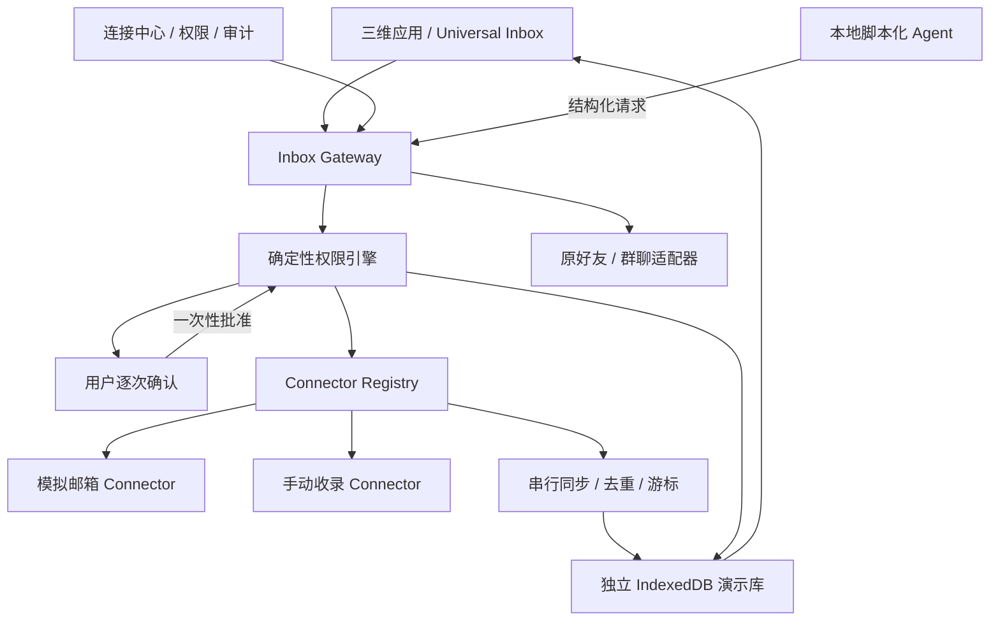

# WeRoam Universal Inbox

本文保留阶段 A 的本地产品 Demo 设计及当时验证记录，描述浏览器中的合成消息、手动收录与确定性脚本助手。“模拟发送”只写入本地演示库。

2026-10-18 桌面能力更新：QQ／163 只读邮箱连接见 [MAIL-INTEGRATION.md](MAIL-INTEGRATION.md)；需单独授权的校内模型对话、分析和本地草稿见 [MAIL-AGENT.md](MAIL-AGENT.md)。下文阶段 A 的“未接入真实邮箱／模型”不适用于新增桌面路径；真实账号验收范围见对应验证记录。

已有好友和群聊仍使用原社交存储与聊天窗口。消息按发件人或群名显示，以昵称旁的软件图标说明来源。通讯录独立记录不同软件的好友；用户上传头像并保存后，通过既有头像生成流程创建三维角色。单纯加载消息示例不调用生成服务。演示库不迁移或重置原聊天数据。

## 架构与信任边界

浏览器内的权限检查是交互流程与逻辑测试，**不能保护真实凭据**：同源代码或开发者工具可以修改浏览器状态。真实接入阶段必须把凭据、最终权限裁决与外部网络操作迁入 Electron 可信执行端；前端与 Agent 仅取得受限数据及动作结果。不能复用现有桌宠 HTTP 桥转发邮箱操作。

Meta Muse 的按连接授权、读写分离、审批和撤销机制提供产品设计参考；其 Sentinel／安全 VM 是 Meta 的产品声明，WeRoam 不声称具有同等隔离。[Meta 官方说明](https://about.fb.com/news/2026/09/introducing-muse-personal-ai-agent/)

## 模块、模型与契约

- Gateway 统一提供会话查询、受限阅读、本地草稿、摘要、同步与发送流程。UI 与 Agent 不直接调用 Connector。
- Connector 描述身份类型、认证方式、能力、执行方式、限制及证据等级；未实现的方法返回 `unsupported`，不能以空列表伪装成功。模拟 Connector 不接受真实密码或令牌。
- 同步按连接串行处理，消息更新、删除标记与游标原子保存。重复或乱序数据不能重复插入；离线失败不推进游标；认证失效等待重新授权。多个窗口采用存储版本比较，陈旧写入返回冲突并刷新，不能静默覆盖新状态。
- 发送采用准备动作、展示明确内容、人工批准、最终执行的顺序。结果不明进入 `unknown`，不自动重复发送。模拟发送不表示平台送达；首版不支持发送附件，手动截图仅作本地阅读素材。
- 本地脚本只从用户明确选择且允许 AI 读取的会话生成引用和回复草稿；外部消息文本不被解释成工具调用或权限命令。

| 实体 | 关键数据 |
|---|---|
| Connection | 所有者、平台、身份类型、演示账号、状态、平台能力、用户权限、授权版本、同步状态 |
| Conversation | 带连接命名空间的 ID、连接、外部会话 ID、参与者、标题、来源与完整性 |
| Message | 连接／会话、平台消息 ID、方向、正文、时间、附件引用及来源 |
| LocalState | 本地已读、置顶、待处理、草稿，与远端状态独立 |
| Action / Approval | 主体、连接、会话、完整命令、内容摘要、授权版本、一次性批准和执行状态 |
| Audit | 时间、动作类型、连接、动作关联及结果；不保存正文、附件内容或凭据 |

来源区分 `native / demo / api / email / notification / manual`。通知摘要不冒充完整消息；人工收录保留“手动”标记。同名账号不自动合并。未来 API 采用“连接＋平台消息 ID”，IMAP 采用“连接＋文件夹＋UIDVALIDITY＋UID”作为去重基线，`Message-ID` 仅辅助。

### 权限与审批

有效权限是平台实际能力、Connector 实现、用户授权、任务范围与必要审批的交集。读取元数据、读取正文、附件、搜索、生成草稿、发送、远端修改、AI 处理分别管理。本地已读不改变平台已读；首版禁止删除、云端 AI 导出和浏览器操作。

批准绑定调用主体、连接、动作命令与授权版本，有效期五分钟且只能使用一次。修改收件人、正文、附件或权限后，旧批准不可用；Agent 不能批准自身动作。撤销立即阻止新调用并作废待执行动作和批准，清除该连接内容、草稿与派生状态，只保留无正文的审计记录。

## 可重复演示

1. `npm run build` 后运行 `npm start`，打开本地演示入口 [Universal Inbox](http://localhost:8080/?scene=forest&inbox=1)，或在任意场景中打开消息列表。该入口只打开收件箱，不会替用户授权、加载数据或发送消息。
2. 点击空状态的“开始体验”，或“更多（···）→ 体验示例”。按需勾选模拟发送与本地助手，点击“加载示例”后自动回到消息列表；两项权限默认关闭。
3. 查看本地好友／群聊与外部来源；点击软件图标筛选来源，账号、未读及待处理筛选收在“更多”内。软件使用用户提供的图标，保留无障碍名称和悬停提示，不重复展示软件名称。
4. 点击“整理回复”，选择消息并确认本次范围。结果出现后自动收起选择区；来源引用按需展开，点击“编辑回复”继续。助手只处理选中的外部会话，不扫描原聊天。模拟发送仍须确认账号、收件人、正文和附件，取消没有外发副作用。
5. 点击“连接”后展开对应软件，按需调整权限；关闭发送后同一草稿不能模拟发送。连接内“更多操作”提供故障情景和断开清除。
6. 通过“更多 → 收录消息”，点击软件图标，手动收录一条微信、QQ、抖音或小红书消息；只可生成草稿、主动复制或打开原平台，不能在 Demo 中声称已发出。查看上传截图需要单独开启“查看附件”；Agent 不识别图片内容。
7. 在“更多 → 体验示例 → 重置演示”清除并重新载入。原有好友和群聊不受影响，可再次从第一步演示。重新载入会替换外部示例、手动收录与外部草稿，须明确勾选替换确认；可先取消以保留内容。

展示界面仅保留简短操作引导；架构、平台限制和验收细节放在本文档。图标从用户指定的 `weroam-slides/assets/app-icons` 复制到 `assets/inbox-icons`，运行时不依赖幻灯片目录。

故障注入只用于开发验收：重复消息、乱序消息、离线、撤销和发送结果不明。它们不产生真实网络访问。

## 通讯录、角色与群聊

- 通讯录以软件图标筛选，分为好友和群聊。可从顶部和底部拖动手柄调整面板高度，也支持手柄的方向键、Home 和 End；视口缩小时限制在屏幕内。
- 好友按软件分别记录昵称、账号、备注和头像；同名／同账号跨软件保持独立，同软件同账号阻止重复录入。姓名、备注与账号可编辑。
- 四位初始好友分别来自微信（团团）、QQ（阿栗）、抖音（小眠）、小红书（山山）。这是本地演示归属，不代表真实平台账号已接入；保留原模型、消息和身份。
- 新好友上传头像后保存，接入既有 `friend-models.js` 任务流程；头像先生成独立参考图，再由既有服务器按项目凭据调用 Rodin。稳定任务 ID 避免编辑、重复点击和刷新重复付费提交。没有头像的示例联系人等待用户补充，不自动批量生成。
- 生成完成后沿用原角色入场、聊天、状态和骨骼适配规则。删除好友记录时移出当前好友与场景，停止离场好友轮询，保留已有聊天历史及任务记录；不承诺撤回已经提交的服务任务。
- 群聊创建及资料页以图标选择所属软件，列表、聊天和场景标签携带同一标识。旧群缺省归为微信演示群，新示例群分配到不同软件；仍使用原本地群聊与场景建筑规则。
- 图标是来源标识，人物头像或群头像是消息主体。消息与通讯录统一使用“头像 → 昵称＋软件图标 → 摘要／账号”的排列，不再在头像角上叠放软件标识。演示消息头像使用已有本地角色肖像；用户提供的头像优先。无可用头像的手动消息使用姓名占位。

新增验收：`node scripts/test-platform-contacts.mjs` 检查跨软件隔离、头像校验、任务身份、持久化、删除、权限及群来源。`node scripts/test-platform-contacts-browser.mjs` 检查人物消息、通讯录筛选、上下拉伸、头像任务去重及恢复、场景角色、群来源和移动端。头像提供方以已有袋鼠模型模拟，未新增真实付费生成；该结果验证接线和交互，不能作为新头像模型质量验收。

## 平台证据与接入路线

下表沿用 2026-10-18 方案阶段的公开文档评估，**不是本次账号实测结果**。公开文档存在不等于 WeRoam 已获得资质；尚未验证的登录、权限、审核与消息完整性不得显示为已支持。

| 平台 | 已有依据与边界 | 实现路线 |
|---|---|---|
| 微信个人号 | 未验证到向普通第三方开放完整私人聊天的 API；微信登录不等于消息授权 | 手动收录、未来单独授权的通知摘要、打开原应用 |
| 微信客服／公众号／企微 | 业务身份与个人聊天不同；客服发送有渠道约束。[腾讯文档](https://cloud.tencent.com/document/product/679/116635) | 取得主体与应用权限后独立 Connector，不包装成个人收件箱 |
| QQ 个人号／机器人 | 机器人消息场景存在，但机器人不是用户本人；推送策略须后台核验。[腾讯文档](https://github.com/tencent-connect/bot-docs/blob/main/docs/develop/api-v2/server-inter/message/send-receive/send.md) | 个人聊天降级，机器人仅接获准事件 |
| 抖音 | 企业私信需要企业身份、申请与用户授权；方案时文档标注暂停发送申请，不支持据此承诺个人或群私信。[官方接口](https://open.douyin.com/platform/resource/docs/openapi/enterprise-open-ability/message-management-enterprise/message-to-user/) | 个人用户降级；企业接入待资质与接口实测 |
| 小红书 | OAuth 基本信息不等于私人聊天；小程序客服是商家场景。[授权索引](https://openaccount.xiaohongshu.com/docs/api-reference)、[客服文档](https://miniapp.xiaohongshu.com/doc/DC897608) | 个人用户降级，商家客服独立评估 |
| QQ 邮箱 | 官方帮助与腾讯集成材料说明 IMAP／客户端授权码路径；权限、开启条件与扩展未实测。[帮助中心](https://service.mail.qq.com/)、[腾讯材料](https://main.qcloudimg.com/raw/document/product/pdf/1270_46586_cn.pdf) | 阶段 B 首个真实测试对象，先 IMAP 只读，再 SMTP 逐次确认 |
| 网易 163／126 | 方案阶段未取得可核验的官方授权码正文；协议限制待验证 | 计划通过邮件协议适配，验证通过前不标记支持 |
| Gmail | 官方 OAuth 有读、发、修改等分级 scope；正文读取可能涉及受限权限和审核。[官方说明](https://developers.google.com/workspace/gmail/api/auth/scopes) | 后续正式 OAuth Connector，权限与审核独立验收 |
| Outlook／Microsoft 365 | Graph 有个人／工作账号委托邮件权限和增量同步，租户可能限制用户同意。[权限说明](https://learn.microsoft.com/en-us/graph/permissions-reference)、[增量同步](https://learn.microsoft.com/en-us/graph/delta-query-messages) | 后续官方 Connector，默认不使用全组织应用权限 |

浏览器自动化默认关闭，逐平台核对条款、域名和动作范围；遇登录验证即暂停。没有 API 不等于允许自动化。不得读取其他应用数据库、解密客户端、调用隐蔽接口、绕过验证码或访问控制。Windows 通知监听也需要系统能力声明及用户授权，现有 Electron 打包是否可用仍待实测；通知可能不完整。[Windows 官方说明](https://learn.microsoft.com/en-us/windows/uwp/design/shell/tiles-and-notifications/notification-listener)

## 安全风险与后续阶段

- **不可信内容与提示注入：**正文以纯文本展示，Agent 不执行其中的指令，不接受任意 URL、脚本、命令或底层协议参数。链接须用户主动打开，消息内容不能扩大授权。
- **误发与撤销竞态：**执行前重新验证权限、主体、命令与授权版本；超时不盲目重试，撤销后禁止旧批准。
- **跨账号隔离：**读取与动作都绑定连接，不按同名联系人合并；搜索、摘要、草稿和审计均保留来源。
- **真实凭据：**后续在可信执行端用 Electron `safeStorage` 包装密钥及加密存储；不可用时禁止保存。DPAPI 不防同用户权限恶意进程，不能宣传为安全 VM。[Electron 官方说明](https://www.electronjs.org/docs/latest/api/safe-storage)
- **真实授权：**原生 OAuth 按平台规则采用系统浏览器、PKCE、`state` 和严格回调。保密客户端密钥不得打进客户端。[原生 OAuth](https://www.rfc-editor.org/rfc/rfc8252)、[OAuth 安全最佳实践](https://www.rfc-editor.org/rfc/rfc9700)
- **邮件授权码范围：**应用只读策略不等于平台只颁发读权限；本地断开不等于平台撤销，必须提供用户在邮箱设置撤销授权码的说明。

| 阶段 | 状态与验收门槛 |
|---|---|
| A 产品 Demo | 本次范围：模拟邮箱、手动收录、原会话投影、权限、审批、脚本化 Agent、重置和本地测试；真实凭据及账号调用均不在其中 |
| B QQ 邮箱闭环 | 待实施：可信执行端、窄 IPC、保险库、加密内容、专用测试账号；验证 IMAP UID 与只读、重连、SMTP 审批及不明结果；网易单独验证 |
| C 官方与降级扩展 | 待实施：Gmail／Graph OAuth 与增量同步、已获批业务 Connector；通知打包与授权实测；浏览器先仅自有测试站 |
| D 真实 Agent 与公开服务 | 待实施：模型适配、独立云端数据授权、保留与删除政策、平台审核及安全测试；不由 Demo 推导公网多用户安全 |

真实数据阶段默认仅同步用户选择的收件箱，首次最近七天、最多 200 封；附件不自动下载，正文保留 30 天。扩展范围需用户操作。这些是后续实施默认值，不是阶段 A 已具有的真实邮件能力。

## 验证入口与证据边界

运行 `npm run test:inbox` 检查独立存储、权限隔离、一次性审批与过期、内容变更、撤销、来源引用、同步去重、离线与不明发送。测试使用 `fake-indexeddb`，不调用真实平台。`npm run test:inbox:browser` 是主应用集成验收入口。

2026-10-18 本机验收结果：

- `npm run build`：通过。收件箱独立 ESM 包约 67 KB；打开消息页后才请求，未进入初始场景包。未据此推导端到端帧率提升。
- `npm run test:inbox`：18 组通过，零网络调用；包含同库并发写入冲突、已提交撤销对其他窗口的即时遮蔽及排队执行撤销。
- `npm run test:inbox:browser`：13 组通过。覆盖三场景共享同一实例、来源与账号筛选、外部草稿、原好友及群聊的独立草稿和附件、只读拒绝发送、拒绝确认、实际确认、引用草稿、撤销清理、桌面与移动端／短视口、44px 主按钮、Escape、重置、持久化入口与失败重试；未观察到外部 HTTP/WebSocket 请求或页面脚本错误。
- `npm test`、`npm run test:performance`、`npm run test:scenes`、`node scripts/test-group-chat.mjs`、`node scripts/test-group-scene.mjs`：通过。群聊旧测试使用的已移除 `cyber` 场景已改为当前理想城。
- 未完成真实平台账号、Electron 真实凭据隔离、系统通知、真实模型或真实 SMTP 验收；这些仍属于阶段 B–D。键盘与触控采用浏览器自动化检查，未进行屏幕阅读器或真实手机硬件验收。

浏览器结果写入 `.test-results/inbox/results.json`（本机生成，不提交）；演示可通过界面重置后重复运行。已保存主流程及通讯录截图：

| 桌面产品流程 | 移动端与场景 |
|---|---|
| [统一列表](images/inbox-desktop-list.jpg) | [移动列表](images/inbox-mobile-list.jpg) |
| [连接与权限](images/inbox-desktop-center.jpg) | [移动权限](images/inbox-mobile-center.jpg) |
| [来源引用与助手](images/inbox-desktop-agent.jpg) | [移动阅读与草稿](images/inbox-mobile-thread.jpg) |
| [发送确认](images/inbox-desktop-approval.jpg) | [森林](images/inbox-scene-forest.jpg) |
| [阅读与模拟发送结果](images/inbox-desktop-thread.jpg) | [富士樱町](images/inbox-scene-fuji.jpg)／[理想城](images/inbox-scene-ideal.jpg) |

| 通讯录与来源 | 头像与群聊 |
|---|---|
| [人物消息](images/inbox-people-messages-desktop.jpg) | [好友编辑](images/inbox-contact-editor-desktop.jpg) |
| [桌面通讯录](images/inbox-contacts-desktop.jpg) | [软件群聊](images/inbox-groups-desktop.jpg) |
| [移动通讯录](images/inbox-contacts-mobile.jpg) | [移动好友资料](images/inbox-contact-editor-mobile.jpg) |
