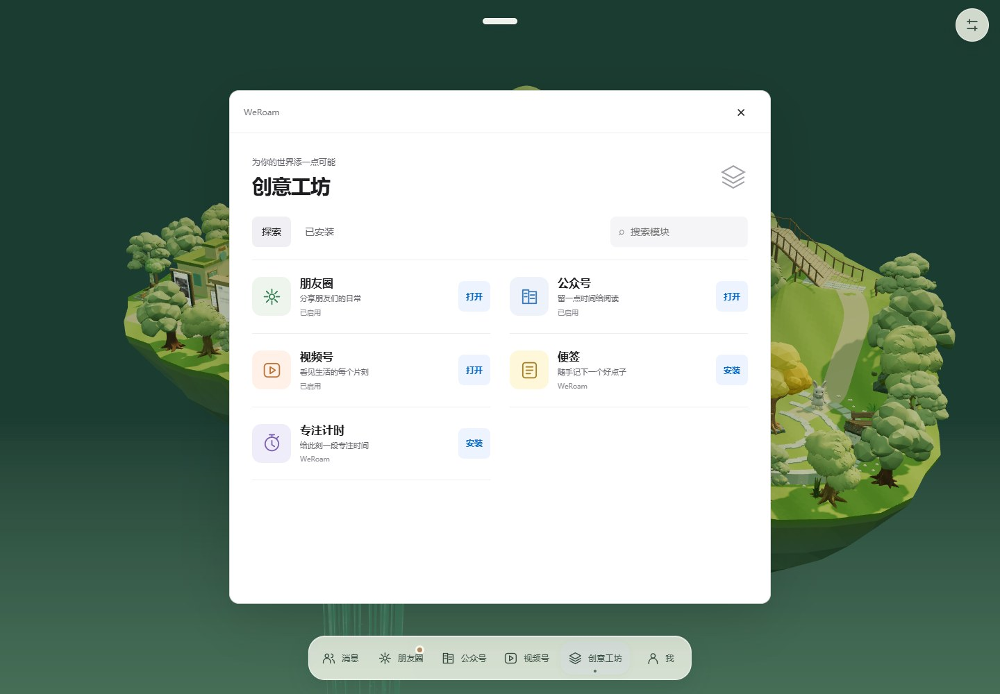
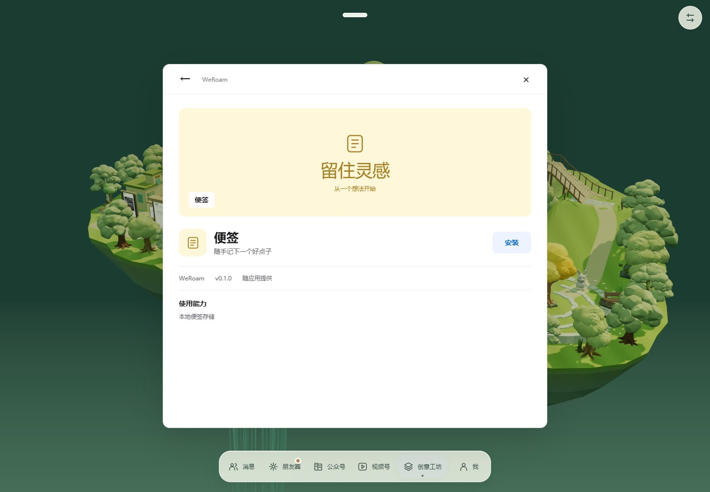
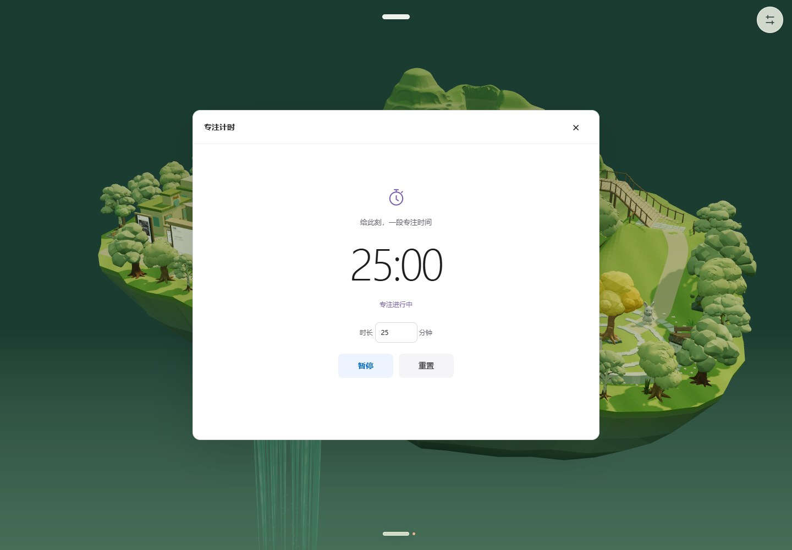
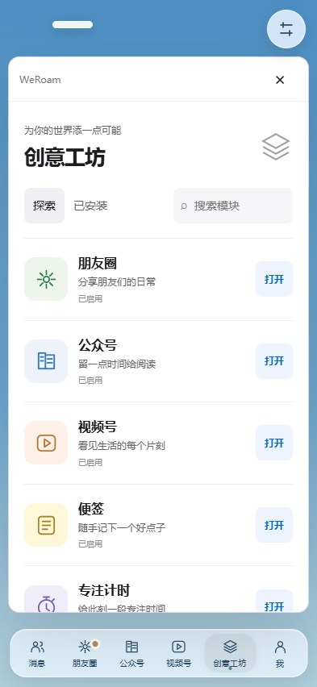
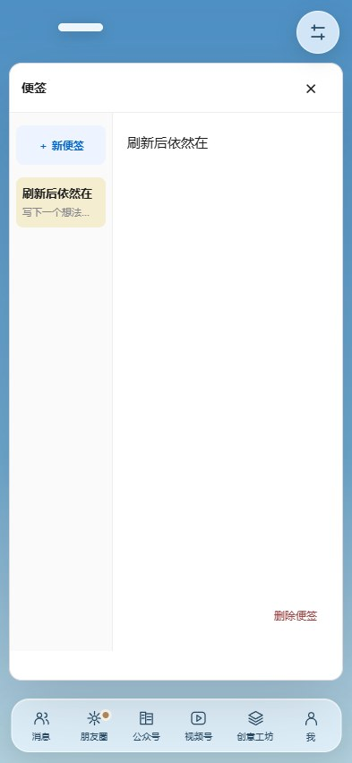

# 创意工坊 · v0.1 beta

打开 `http://localhost:8080/?scene=fuji&workshop=1`，或展开底部悬浮条进入“创意工坊”。不需要连接账号。

## 使用

| 模块 | 首次打开 | 使用方式 |
| --- | --- | --- |
| 朋友圈 | 已安装、启用并固定 | 打开原有动态、发表、点赞、评论及好友朋友圈 |
| 公众号 | 已安装、启用并固定 | 订阅、阅读、收藏、分享原有本地文章 |
| 视频号 | 已安装、启用并固定 | 播放、关注、留言、收藏及分享原有本地视频 |
| 便签 | 待安装 | 安装后打开，新增便签并输入，自动保存到本机 |
| 专注计时 | 待安装 | 默认 25 分钟，可设置 1–180 分钟；支持暂停、继续及重置 |

探索页显示五个随应用提供的模块。“已安装”筛选本机安装记录，搜索只筛选模块名称和介绍。点击模块图标打开详情，可安装、启用、停用、固定、卸载或清除数据。卸载保留内容，清除数据需单独确认。

底部固定保留消息、创意工坊、我；固定的已启用模块插入其中。手机端模块区可横向滚动。桌面鼠标靠近展开、离开约 300ms 收起，键盘及触摸沿用现有导航机制。

公众号或视频号停用后，三个场景中的对应设施、牌面和标签一起隐藏，拾取、遮挡、避障及标签占位也失效。重新启用恢复原位置；需要让位的角色平滑移动，不重建角色或聊天界面。

## 实现与边界

- `src/mods/catalog.js`：稳定模块 ID、手工 SVG 图标、预览、版本、作者和能力说明。仅允许五个随应用发布的模块，没有远程目录、包导入或任意脚本执行。
- `src/mods/manager.js`、`store.js`：统一打开与状态变更入口，加载重试及并发加载去重、独立 IndexedDB `weroam-workshop-v1`、串行事务、跨窗口状态通知、暂停及结束计时。
- `src/mods/ui.js`：按需加载的工坊、详情、便签、计时和确认界面。`dist/workshop.js` 独立于首屏场景包，并包含在 Android 离线资源清单内。
- 现有朋友圈、文章、视频及其收藏、进度继续使用原社交库，无数据搬迁。工坊状态和新增模块内容使用独立库，安装不代表取得任何外部平台授权。
- 专注计时关闭面板后继续，按结束时间计算剩余时间；停用或卸载暂停。后台计时受浏览器调度影响，返回前台后校准；仅应用内提示，不申请系统通知权限。
- 便签仅在本机存储。界面显示“已保存到本机”后才表示事务完成；存储失败保留编辑缓冲并提示重试。
- 本次不重建或发布 APK、不提交或推送 Git。下载页上的 APK 仍是此前构建，不能作为本次工坊功能的安装包。

## 验证

```powershell
npm run build
npm test
npm run test:inbox
npm run test:mods
npm run test:mods:browser
npm run test:interactions
npm run test:browser
npm run test:boards
npm run test:anchors
npm run android:web
npm run test:android
```

工坊浏览器检查覆盖实际安装与固定、取消卸载、卸载重装保留便签、删除与刷新恢复、计时结束与暂停、聊天草稿、三场景设施显隐、失败切换回退、不可用内容跳转工坊，以及桌面/手机布局。设施单元测试验证已缓存的碰撞和射线不会命中停用设施，重新启用可以恢复。

测量和截图原件保存在 `.test-results/workshop/`，其中 `results.json` 记录启停前后资源数量。此测量用于判断反复启停是否持续增加资源，不代表已完成实体手机帧率验收。

### 本次执行结果

构建、模块事务/设施单元检查、工坊桌面与手机浏览器流程、Inbox 与跨平台联系人浏览器回归、社交与内容存储检查、桌面/触摸交互、文章与视频阅读、三维牌面、好友标签跟随与点击、现有三场景及 Android 离线资源检查均通过。工坊浏览器记录没有 JavaScript 错误、缺失资源或外部网络请求；现有本机桌宠桥接仍可轮询。

预热三个场景并生成四名好友后，连续切换五轮（15 次）：富士樱町几何/纹理为 267/91，理想城为 87/35，森林为 224/96，各轮与该场景基线一致，均只有一个场景根节点、两个模块监听器。工坊打开后反复启停五轮前后均为 88 个几何、35 个纹理、三个模块监听器。详细记录见 [启停检查](validation/workshop.json) 与 [切换检查](validation/workshop-switch-stability.json)。这些是桌面浏览器资源计数，不是实体手机内存或性能保证。

Android 离线目录包含 278 个文件（约 320 MiB），实测断网可打开三个场景及工坊、安装便签并持久保存。尚未重新打包 APK，也未做实体 Android 手机验收。

## 界面截图








三个场景的设施启用/停用对照，以及手机模块详情和底部导航，也保存在 `docs/images/workshop/`。
